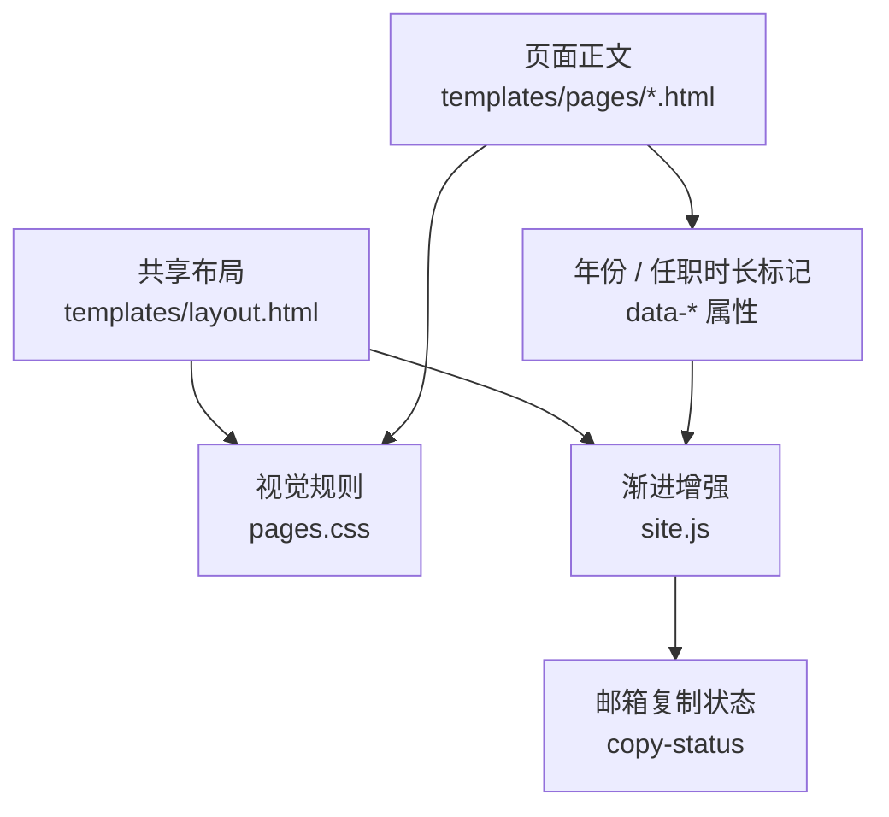
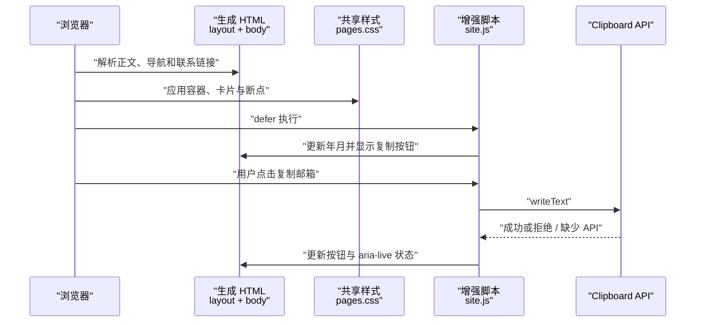
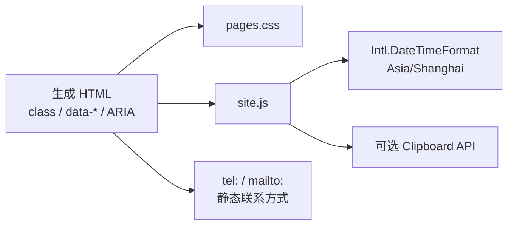

# 交互与样式

## 目录
1. [简介](#简介)
2. [项目结构](#项目结构)
3. [核心组件](#核心组件)
4. [架构总览](#架构总览)
5. [详细组件分析](#详细组件分析)
6. [依赖关系分析](#依赖关系分析)
7. [性能与一致性考量](#性能与一致性考量)
8. [故障排查指南](#故障排查指南)
9. [结论](#结论)

## 简介

全站通过一份共享 `pages.css` 和一份短小的 `site.js` 保持页面一致。CSS 管理视觉变量、导航、卡片和响应式布局，JavaScript 则只增强年份、任职时长和邮箱复制。正文、导航以及联系链接均来自静态 HTML，浏览器脚本没有承担页面路由或数据获取。

章节来源
- [pages.css:1-26](file://pages.css#L1-L26)
- [site.js:1-20](file://site.js#L1-L20)
- [templates/layout.html:24-51](file://templates/layout.html#L24-L51)

## 项目结构

视觉与交互源码放在仓库根目录，共享布局负责引入资源、定义交互所需的 DOM 标记。正文模板只提供语义内容和对应 CSS class；最终生成的每个页面都经过同一布局，因此基础样式和增强逻辑共用同一入口。

```
pages.css
site.js
templates/
  layout.html
  pages/
    index.html
    contact.html
    resume.html
```

以下结构图说明正文与共享布局如何分别向 CSS 和脚本提供选择器，而不是形成组件框架。



图表来源
- [templates/layout.html:24-43](file://templates/layout.html#L24-L43)
- [site.js:6-20](file://site.js#L6-L20)
- [templates/pages/index.html:1-19](file://templates/pages/index.html#L1-L19)

图中最重要的边界是 CSS 只决定呈现，脚本只更新已有 DOM；两者都不生成页面导航结构。

章节来源
- [templates/layout.html:24-51](file://templates/layout.html#L24-L51)
- [pages.css:49-60](file://pages.css#L49-L60)
- [site.js:6-20](file://site.js#L6-L20)

## 核心组件

组件以文件和 DOM 契约组织，不依赖第三方 UI 库。样式变量覆盖颜色、容器、圆角和字体，布局模板则固定按钮、状态区域和页脚标记，浏览器脚本据此执行有限的增强。

- `pages.css`：统一容器、sticky 顶栏、首页入口卡片、子页面板、联系卡片、时间线和三个宽度断点。
- `site.js`：加载后计算上海时区年月，更新已标记的年份与任职时长，绑定邮箱复制事件。
- `templates/layout.html`：以 `defer` 引入脚本，输出默认隐藏的复制按钮、无脚本邮件入口和实时状态区域。
- `templates/pages/index.html`：组织 hero、能力概览和三个页面入口卡片。
- `templates/pages/contact.html`：用 `tel:`、`mailto:` 链接构造无需脚本的联系卡片。

章节来源
- [pages.css:49-111](file://pages.css#L49-L111)
- [pages.css:116-196](file://pages.css#L116-L196)
- [site.js:5-42](file://site.js#L5-L42)
- [templates/layout.html:24-43](file://templates/layout.html#L24-L43)
- [templates/pages/contact.html:10-19](file://templates/pages/contact.html#L10-L19)

## 架构总览

浏览器先解析静态页面并应用共享 CSS，随后执行 `defer` 脚本。日期更新与邮箱复制各自使用现成的 DOM 标记；复制操作只有在用户点击之后才访问剪贴板，成功和失败都将状态反馈给用户。



图表来源
- [templates/layout.html:24-43](file://templates/layout.html#L24-L43)
- [site.js:6-42](file://site.js#L6-L42)
- [pages.css:207-243](file://pages.css#L207-L243)

这条路径说明剪贴板能力是可失败的附加功能，静态邮件链接始终由 HTML 提供。

章节来源
- [templates/layout.html:38-51](file://templates/layout.html#L38-L51)
- [site.js:17-42](file://site.js#L17-L42)

## 详细组件分析

### 渐进增强与无障碍反馈

脚本按 `Asia/Shanghai` 更新 `data-current-year` 和 `data-experience-start` 元素，不请求服务器时间。复制处理过程中暂时禁用按钮，成功后显示“已复制”，失败后给出可手动选中的邮箱；`finally` 重新启用按钮并展示状态。共享布局通过 `aria-describedby`、`role="status"` 和 `aria-live="polite"` 把状态与操作关联。

本章的《渐进增强与无障碍反馈》主题集中解释日期算法、DOM 契约和剪贴板的失败路径。其范围限定在源码现有行为，页面没有更复杂的前端状态库或浏览器事件总线。

章节来源
- [site.js:6-42](file://site.js#L6-L42)
- [templates/layout.html:38-43](file://templates/layout.html#L38-L43)

### 响应式视觉系统

CSS 使用 `:root` 变量和普通 class 管理视觉体系，通用容器最大宽度为 `1120px`。在 `900px` 以下，首页入口和内容网格改为单列、数据条改为两列；在 `720px` 以下，头部操作区隐藏、导航可横向滚动、容器左右留白缩小；在 `480px` 以下，品牌文字隐藏。键盘焦点有独立轮廓，入场动画只在用户未请求减少动态效果时启用。

本章的《响应式视觉系统》主题说明具体选择器、模板 class 和断点变化。调整页面结构时应同时检查共享布局和正文中的 class 是否仍被 CSS 覆盖。

章节来源
- [pages.css:7-26](file://pages.css#L7-L26)
- [pages.css:47-60](file://pages.css#L47-L60)
- [pages.css:198-243](file://pages.css#L198-L243)

## 依赖关系分析

运行时依赖来自浏览器内置 DOM、CSS、`Intl.DateTimeFormat` 和可选的 Clipboard API。布局必须提供准确的选择器与 data 属性；CSS 和脚本没有包管理依赖。剪贴板 API 不可用会进入已实现的失败反馈，静态电话和邮件联系仍由链接承担。

- 必选：生成 HTML 中的 class、`data-current-year` 和交互 DOM 元素，是样式和脚本的定位依据。
- 必选：浏览器 DOM 和 `Intl.DateTimeFormat`，用于元素查找、年月计算和文本更新。
- 可选：`navigator.clipboard.writeText`，仅影响复制操作；脚本在缺少 API 时捕获失败。

以下依赖图把静态呈现和复制增强的边界放在同一张图中。



图表来源
- [templates/layout.html:26-51](file://templates/layout.html#L26-L51)
- [site.js:6-42](file://site.js#L6-L42)
- [templates/pages/contact.html:10-19](file://templates/pages/contact.html#L10-L19)

图中联系链接直接依赖 HTML，复制按钮则额外依赖脚本和剪贴板接口。

章节来源
- [site.js:6-42](file://site.js#L6-L42)
- [templates/layout.html:26-51](file://templates/layout.html#L26-L51)

## 性能与一致性考量

全站共享一份样式和一份脚本，脚本不请求 API，也不持续轮询；其工作集中在加载时更新日期和点击时复制邮箱。静态 HTML 为无脚本环境保留正文、导航和联系入口，而运行时日期只修正标记元素，不改变历史事实。CSS 断点和 `clamp` 用于适配布局，媒体偏好限制 hero 入场动画。

- `defer` 让增强脚本在文档解析后执行，选择器可定位布局已提供的元素。
- 复制期间 `disabled` 阻止重复触发，`finally` 在成功或失败后恢复操作。
- `720px` 以下隐藏头部操作区，因此移动端需要依赖正文和页脚联系入口。
- `[hidden]` 强制隐藏默认复制按钮与状态区域，脚本通过 `hidden = false` 显示它们。
- 日期按浏览器本地时钟和上海时区计算，网页没有服务器时间同步机制。

章节来源
- [templates/layout.html:26-51](file://templates/layout.html#L26-L51)
- [site.js:6-14](file://site.js#L6-L14)
- [site.js:27-40](file://site.js#L27-L40)
- [pages.css:28-29](file://pages.css#L28-L29)
- [pages.css:198-243](file://pages.css#L198-L243)

## 故障排查指南

排查时先观察视口宽度，再核对生成页面的 DOM 标记和脚本是否加载。视觉问题通常定位到 class 与断点，复制问题定位到按钮、状态区域或 Clipboard API，日期问题则定位到对应 data 属性。

- **现象：移动端看不到顶部复制按钮。** 原因可能是 `720px` 断点主动隐藏 `.header-actions`。定位步骤：调宽视口并查看 `pages.css:220-232`，再检查联系页和页脚链接是否可用。
- **现象：桌面端复制按钮仍然隐藏。** 原因可能是脚本没有执行，或按钮/状态选择器缺失导致提前返回。定位步骤：检查布局中的 `defer` 引入和 `data-copy-email`、`#copy-status`；源码位置为 `site.js:17-20`。
- **现象：点击后出现无法自动复制。** 原因是 Clipboard API 缺少或拒绝写入。定位步骤：查看显示出的邮箱并尝试手动复制，再核查 `site.js:29-39` 的错误分支；页面没有失败时自动打开邮件客户端。
- **现象：年份或任职时长不更新。** 原因可能是脚本未加载或 DOM 标记缺少。定位步骤：检查 `data-current-year`、`data-experience-start` 与浏览器时钟，源码位置为 `site.js:6-14`。
- **现象：卡片没有正常排列。** 原因可能是模板 class 与 CSS 不一致，或处于单列断点。定位步骤：核对 `.home-entry`、`.content-grid` 和 `900px` 媒体查询，源码位置为 `pages.css:138-160`、`208-219`。

章节来源
- [site.js:6-20](file://site.js#L6-L20)
- [site.js:27-42](file://site.js#L27-L42)
- [pages.css:138-160](file://pages.css#L138-L160)
- [pages.css:208-243](file://pages.css#L208-L243)

## 结论

交互与样式围绕静态 HTML 的共享契约组织，适合当前无需前端框架的作品集网站。维护时优先保证模板语义、CSS class 和脚本选择器一致，再分别验证宽屏、窄屏、无脚本与剪贴板失败的用户行为。

章节来源
- [templates/layout.html:26-51](file://templates/layout.html#L26-L51)
- [site.js:1-4](file://site.js#L1-L4)
- [pages.css:207-243](file://pages.css#L207-L243)

<cite>
**本文引用的文件**
- [pages.css](file://pages.css)
- [site.js](file://site.js)
- [templates/layout.html](file://templates/layout.html)
- [templates/pages/index.html](file://templates/pages/index.html)
- [templates/pages/contact.html](file://templates/pages/contact.html)
</cite>
