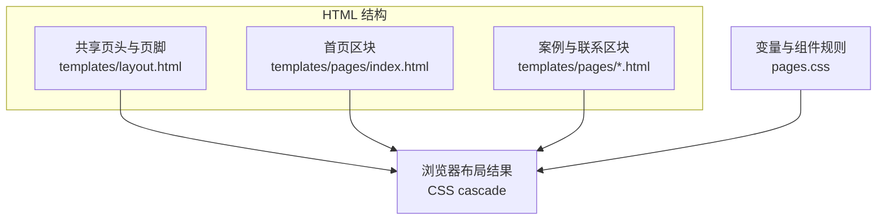
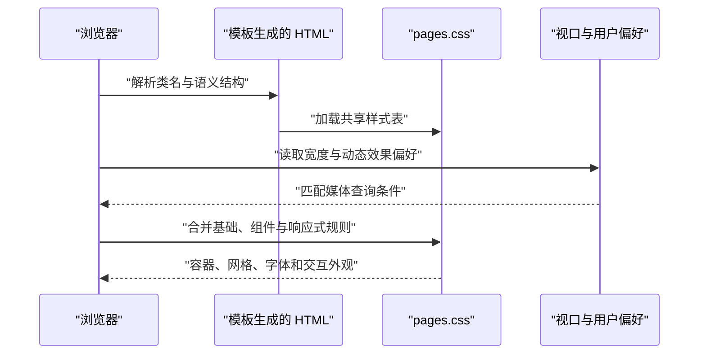
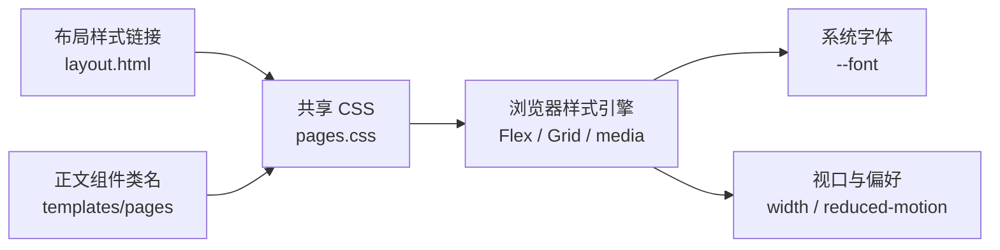

# 响应式视觉系统

## 目录
1. [简介](#简介)
2. [项目结构](#项目结构)
3. [核心组件](#核心组件)
4. [架构总览](#架构总览)
5. [详细组件分析](#详细组件分析)
6. [依赖关系分析](#依赖关系分析)
7. [性能与一致性考量](#性能与一致性考量)
8. [故障排查指南](#故障排查指南)
9. [结论](#结论)

## 简介
`pages.css` 是八页作品集共用的视觉系统，以 CSS 自定义属性、共享选择器和三个宽度断点控制布局。HTML 模板通过 `home-hero`、`content-grid`、`panel` 等类名选择规则，页面不依赖组件框架来呈现这些结构。颜色变量只定义一套固定配色，文件中没有主题切换实现；字体优先使用操作系统提供的中文与西文字体。

- 内容容器最大宽度为 `1120px`，默认两侧合计预留 `40px`。
- 首页有四列数据条与三列入口卡片，子页通常采用两列内容网格。
- 宽度适配断点为 `900px`、`720px`、`480px`。
- 键盘焦点使用蓝色轮廓，hero 入场动画仅在没有减少动态效果偏好时启用。

章节来源
- [pages.css:7-60](file://pages.css#L7-L60)
- [pages.css:131-158](file://pages.css#L131-L158)
- [pages.css:198-243](file://pages.css#L198-L243)

## 项目结构
共享布局负责挂载样式表和站点外壳，正文模板提供可被 CSS 匹配的类名。首页、案例目录和联系页各自选择共享组件，再用少量专属类调整结构。样式文件本身只负责视觉，不存储页面文案，也不在访问时读取站点配置。

```
pages.css
templates/
  layout.html
  pages/
    index.html
    portfolio.html
    contact.html
    case-visual.html
```

- `pages.css` 从变量、基础元素、容器一路定义到页头、hero、网格、页脚、动效与响应式规则。
- `templates/layout.html` 在 `head` 中引用 `pages.css`，提供 `site-header`、`main-nav` 和 `site-footer`。
- `templates/pages/index.html` 提供首页 hero、数据条与三个入口卡片。
- 案例和联系正文复用 `page-hero`、`content-grid`、`panel`，而截图使用 `evidence`。

下面的结构图展示类名来自何处、样式由何处统一解释，便于确定视觉修改范围。



同一个选择器可以作用于多页模板，因此通用规则变化会同步影响所有使用该类名的页面。

图表来源
- [templates/layout.html:26-53](file://templates/layout.html#L26-L53)
- [templates/pages/index.html:1-85](file://templates/pages/index.html#L1-L85)
- [templates/pages/portfolio.html:1-42](file://templates/pages/portfolio.html#L1-L42)
- [pages.css:49-60](file://pages.css#L49-L60)

章节来源
- [pages.css:1-6](file://pages.css#L1-L6)
- [templates/layout.html:26-53](file://templates/layout.html#L26-L53)
- [templates/pages/index.html:1-85](file://templates/pages/index.html#L1-L85)
- [templates/pages/contact.html:1-19](file://templates/pages/contact.html#L1-L19)
- [templates/pages/case-visual.html:1-33](file://templates/pages/case-visual.html#L1-L33)

## 核心组件
视觉系统先建立文字、颜色和盒模型的共同基础，再通过区块类名组织布局。最大宽度、颜色、圆角、阴影和字体保存在 `:root` 中；间距和字号多数仍在具体选择器中以固定值或 `clamp()` 表达。维护时应区分全站变量与组件局部规则，避免认为所有尺寸都已抽象为变量。

- 设计变量：`--container`、`--canvas`、`--ink`、`--muted` 等定义基础配色与容器，`--radius-lg`、`--radius-md`、`--shadow-1`、`--shadow-2` 提供卡片质感。
- 基础规则：全局 `border-box`、图片自适应和元素 margin 重置建立统一基础，`[hidden]` 强制隐藏带该属性的元素。
- 共享容器：页头、页脚、hero、数据条、入口与内容网格分别共享同一宽度计算与水平居中。
- 页头与导航：sticky 顶栏使用 Flex 排列品牌、导航和动作，当前链接由 `.current` 显示蓝色下划线。
- 卡片与网格：`.entry-card` 服务首页入口，`.panel` 服务正文块，`.wide` 让项目横跨全部网格列。
- 联系与证据：`.contact-card` 调整联系方式排版，`.evidence` 为截图提供全宽、边框和圆角。
- 扩展位置：增加页面组件时可复用已有类，新增配色或全站尺寸时可扩展 `:root` 与对应选择器。

章节来源
- [pages.css:7-60](file://pages.css#L7-L60)
- [pages.css:63-111](file://pages.css#L63-L111)
- [pages.css:137-170](file://pages.css#L137-L170)

## 架构总览
浏览器加载共享 CSS 后，基础规则先提供默认布局，媒体查询再根据视口宽度覆盖部分属性。`clamp()` 使标题与部分间距在断点之间连续变化，Grid 列数则在明确断点发生切换。鼠标悬停、键盘焦点和动态效果偏好由 CSS 伪类与媒体查询直接匹配，无需脚本计算屏幕宽度。

下面的时序图展示视口与交互状态如何影响同一份 HTML 的最终样式。



视口改变后浏览器重新匹配规则，页面仍使用原来的卡片和导航元素，而不是生成另一套移动端页面。

图表来源
- [templates/layout.html:24-27](file://templates/layout.html#L24-L27)
- [pages.css:47-60](file://pages.css#L47-L60)
- [pages.css:117-121](file://pages.css#L117-L121)
- [pages.css:198-243](file://pages.css#L198-L243)

章节来源
- [pages.css:47-60](file://pages.css#L47-L60)
- [pages.css:117-121](file://pages.css#L117-L121)
- [pages.css:198-243](file://pages.css#L198-L243)
- [templates/layout.html:24-27](file://templates/layout.html#L24-L27)

## 详细组件分析
组件规则按页面外壳、首页和通用子页组织，便于从 HTML 的类名回到样式位置。响应式部分位于文件末尾，使用相同类名覆盖列数、间距和显示状态。以下说明只对应现有选择器，不把颜色变量、CSS 网格或 hover 效果扩展解释为主题系统或前端框架。

章节来源
- [pages.css:62-243](file://pages.css#L62-L243)
- [templates/layout.html:30-53](file://templates/layout.html#L30-L53)

### 变量、容器与共享页头页脚
`body` 使用浅灰到近白的渐变背景，正文颜色为 `--ink`，基础字体为 `15px/1.75` 的系统字体栈。容器规则直接列出多个区块选择器，使用 `width: min(var(--container), 100% - 40px)` 与 `margin-inline: auto`；布局中的 `page-wrap` 并没有独立宽度声明。顶栏固定在滚动容器顶部，页脚采用可换行的 Flex 布局。

- `.site-header` 使用 `position: sticky`、`top: 0`、`z-index: 50`，并以半透明背景和 `backdrop-filter` 产生视觉层次。
- `.header-inner` 默认高 `64px`；品牌不换行，导航通过 `margin-left: auto` 靠向右侧。
- `.main-nav a.current` 加深文字并通过 `::after` 绘制 `2px` 蓝色底线。
- `.footer-inner` 用 `justify-content: space-between` 与 `flex-wrap: wrap` 排列版权和联系方式。
- `.copy-mail` 与 `.dark` 分别是浅色描边按钮和深色联系链接；两者的视觉规则不改变实际 HTML 行为。

章节来源
- [pages.css:7-60](file://pages.css#L7-L60)
- [pages.css:63-111](file://pages.css#L63-L111)
- [pages.css:192-196](file://pages.css#L192-L196)
- [templates/layout.html:30-53](file://templates/layout.html#L30-L53)

### 首页、案例与联系类名对应
首页模板把介绍、状态、能力条和入口明确拆成 `.home-hero`、`.home-stats`、`.home-entry`。案例目录的可点击面板使用 `<a class="panel">`，因此会获得 `a.panel:hover` 的浮起与阴影；案例详情的普通 `<div class="panel">` 没有这条链接悬停效果。联系页在同一个 `.content-grid` 中叠加 `.contact-card`，用较小标签和较大的联系方式强调可点击信息。

- 首页 hero 的标题默认在 `40px` 到 `72px` 之间变化；简介最大宽度为 `640px`。
- 首页数据条默认四列，三个入口默认三列；入口颜色来自 `entry-yellow`、`entry-lilac`、`entry-mint`。
- 案例目录默认两列，第三张 `panel wide` 卡片横跨全部列。
- 联系面板的最小高度为 `190px`，`.contact-value` 字号在 `20px` 到 `28px` 之间变化。
- 视觉案例的截图使用 `evidence`，宽度为 `100%`；全局图片规则同时保证最大宽度不超过父级且高度按比例调整。

章节来源
- [templates/pages/index.html:1-85](file://templates/pages/index.html#L1-L85)
- [templates/pages/portfolio.html:10-42](file://templates/pages/portfolio.html#L10-L42)
- [templates/pages/contact.html:10-19](file://templates/pages/contact.html#L10-L19)
- [templates/pages/case-visual.html:11-33](file://templates/pages/case-visual.html#L11-L33)
- [pages.css:117-170](file://pages.css#L117-L170)

### 断点、溢出与交互状态
响应式规则使用三个 `max-width` 查询，因此更窄的视口会同时继承较宽断点的调整。`900px` 以下改变列数，`720px` 以下收紧页边距和顶栏，`480px` 以下仅隐藏品牌文字。导航保持横排并允许横向滚动，没有折叠菜单或汉堡按钮规则。

- 宽度不大于 `900px`：首页入口与内容网格变为一列，数据条变为两列，指标条变为一列，并重排分隔线。
- 宽度不大于 `720px`：容器改为 `100% - 32px`，页头高 `56px`，`.header-actions` 隐藏，导航启用 `overflow-x: auto` 并隐藏滚动条。
- 同一 `720px` 规则还缩小 hero 顶部间距、调整标题 `clamp()` 范围、把面板与入口内边距改为 `24px`。
- 宽度不大于 `480px`：`.brand-name` 隐藏，但品牌标记保留。
- 数据条与指标条使用 `overflow: hidden` 约束圆角边界；导航使用的是可滚动溢出，两者目的不同。
- 链接和按钮的 `:focus-visible` 为键盘焦点提供蓝色轮廓；hover 会改变部分颜色、阴影或纵向位移。
- hero 的 `rise` 入场动画受 `prefers-reduced-motion: no-preference` 控制，hover 的过渡规则并未放在该查询中。

章节来源
- [pages.css:47-47](file://pages.css#L47-L47)
- [pages.css:77-110](file://pages.css#L77-L110)
- [pages.css:131-160](file://pages.css#L131-L160)
- [pages.css:177-181](file://pages.css#L177-L181)
- [pages.css:198-243](file://pages.css#L198-L243)

## 依赖关系分析
样式体系的必需依赖是浏览器加载 `pages.css`，以及 HTML 使用匹配的类名和元素类型。字体通过系统字体栈选择，不引入远程字体下载；颜色与尺寸来自本地规则。页面脚本负责其他交互时，CSS 仍通过 `hidden`、`disabled` 和状态类提供对应外观。

- 必选：共享布局中的 `<link rel="stylesheet" href="pages.css">` 与正文中的组件类名。
- 必选：浏览器对 Flex、Grid、自定义属性、媒体查询与 `clamp()` 的解析能力；仓库样式文件没有声明具体最低浏览器版本。
- 推荐：系统存在字体栈中的中文字体，以得到预期文字排版；最后保留 `sans-serif` 回退。
- 可选：`backdrop-filter` 提升顶栏玻璃感，样式同时定义半透明背景与 WebKit 属性。
- 可选：浏览器对 `text-wrap: balance`、`scrollbar-width` 等属性的支持影响细节显示，相关结构仍由基础布局描述。

下面的依赖图按“结构匹配”和“浏览器环境”分出样式生效的条件，适合排查不同设备间的差异。



类名匹配决定哪些规则进入候选集，浏览器能力、字体和视口则决定具体渲染结果。

图表来源
- [templates/layout.html:26-26](file://templates/layout.html#L26-L26)
- [templates/pages/contact.html:10-19](file://templates/pages/contact.html#L10-L19)
- [pages.css:25-25](file://pages.css#L25-L25)
- [pages.css:63-69](file://pages.css#L63-L69)
- [pages.css:198-243](file://pages.css#L198-L243)

章节来源
- [templates/layout.html:26-27](file://templates/layout.html#L26-L27)
- [pages.css:25-47](file://pages.css#L25-L47)
- [pages.css:63-69](file://pages.css#L63-L69)
- [pages.css:131-170](file://pages.css#L131-L170)
- [pages.css:198-243](file://pages.css#L198-L243)

## 性能与一致性考量
一份共享 CSS 让各页复用相同设计规则，避免为每页维护重复样式。布局使用原生 CSS 计算视口变化，动态效果主要作用于 `transform`、阴影和透明度；源码没有提供性能基准或缓存策略，因此不能量化加载和重绘收益。固定图片比例与响应式宽度也需要同时阅读 HTML 属性和 CSS 规则，才能判断实际布局。

- 系统字体栈避免额外远程字体引用，但不同系统可能呈现不同字形和换行。
- `minmax(0, 1fr)` 和导航的 `min-width: 0` 为较窄容器中的收缩留出空间。
- `clamp()` 把标题字号限制在上下界，避免按视口比例无限放大或缩小。
- 入口和链接面板共享 hover 规则，非链接面板不产生同样的浮起效果。
- hero 入场动画尊重减少动态效果偏好；其他 hover 过渡仍按原规则保留。
- `evidence` 与全局图片规则控制显示宽度，截图模板本身还声明真实宽高及懒加载。

章节来源
- [pages.css:25-25](file://pages.css#L25-L25)
- [pages.css:40-40](file://pages.css#L40-L40)
- [pages.css:76-76](file://pages.css#L76-L76)
- [pages.css:117-170](file://pages.css#L117-L170)
- [pages.css:198-205](file://pages.css#L198-L205)
- [templates/pages/case-visual.html:29-31](file://templates/pages/case-visual.html#L29-L31)

## 故障排查指南
视觉排查先检查对应 HTML 类名，再确认正在生效的断点和选择器。移动端的隐藏动作区、单列卡片和横向滚动导航都是明确规则，不能仅凭外观判断为内容丢失。对于浏览器差异，优先看 computed styles 和字体匹配结果，再区分缺失资源与不支持的属性。

- 窄屏看不到顶栏复制邮箱或联系按钮 → `720px` 以下隐藏 `.header-actions` → 检查视口宽度和对应 computed display，联系正文仍提供直接链接 → 定位 `pages.css` 第 220–231 行与联系模板第 10–19 行。
- 卡片从并排变为纵排 → `900px` 以下覆盖 `.home-entry`、`.content-grid` 的列数 → 检查媒体查询是否匹配，并比较较宽视口 → 定位 `pages.css` 第 208–214 行。
- 小屏导航似乎只显示部分项目 → 导航保持横排并使用隐藏滚动条的横向滚动 → 检查是否可左右滚动，不要寻找源码中不存在的折叠菜单 → 定位 `pages.css` 第 231–232 行。
- 卡片没有悬停浮起 → 规则仅作用于 `.entry-card` 与 `a.panel` → 检查元素是 `<a>` 还是 `<div>`，再确认 hover 状态 → 定位 `pages.css` 第 139–140、159–160 行与视觉案例模板第 11–29 行。
- 英文或中文换行与另一台设备不同 → 系统字体栈及 `text-wrap: balance` 支持存在环境差异 → 查看实际使用字体、字号和容器宽度，再测试相同视口 → 定位 `pages.css` 第 25、43、58 行。
- 键盘聚焦时出现蓝色轮廓 → `:focus-visible` 提供明确焦点反馈 → 使用 Tab 检查链接和按钮的定位，保留该反馈有助于确认当前位置 → 定位 `pages.css` 第 47 行。

章节来源
- [pages.css:25-60](file://pages.css#L25-L60)
- [pages.css:139-160](file://pages.css#L139-L160)
- [pages.css:208-243](file://pages.css#L208-L243)
- [templates/pages/contact.html:10-19](file://templates/pages/contact.html#L10-L19)
- [templates/pages/case-visual.html:11-29](file://templates/pages/case-visual.html#L11-L29)

## 结论
响应式视觉系统以一份原生 CSS 连接共享布局和各页正文，核心组织方式是变量、组件类名与明确的媒体查询覆盖。维护时应先判断修改影响全站还是单个组件，再检查 `900px`、`720px` 和 `480px` 下的实际结构。现有样式提供固定配色、横向滚动导航和有限动态效果，应按这些已实现行为解释页面。

章节来源
- [pages.css:7-26](file://pages.css#L7-L26)
- [pages.css:198-243](file://pages.css#L198-L243)
- [templates/layout.html:26-53](file://templates/layout.html#L26-L53)

<cite>
**本文引用的文件**
- [pages.css](file://pages.css)
- [layout.html](file://templates/layout.html)
- [index.html](file://templates/pages/index.html)
- [portfolio.html](file://templates/pages/portfolio.html)
- [contact.html](file://templates/pages/contact.html)
- [case-visual.html](file://templates/pages/case-visual.html)
</cite>
