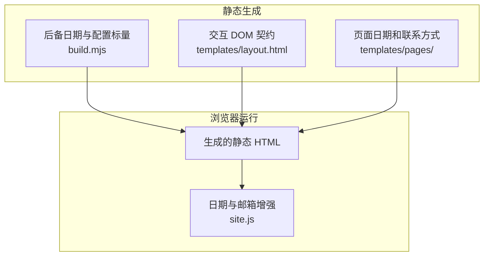
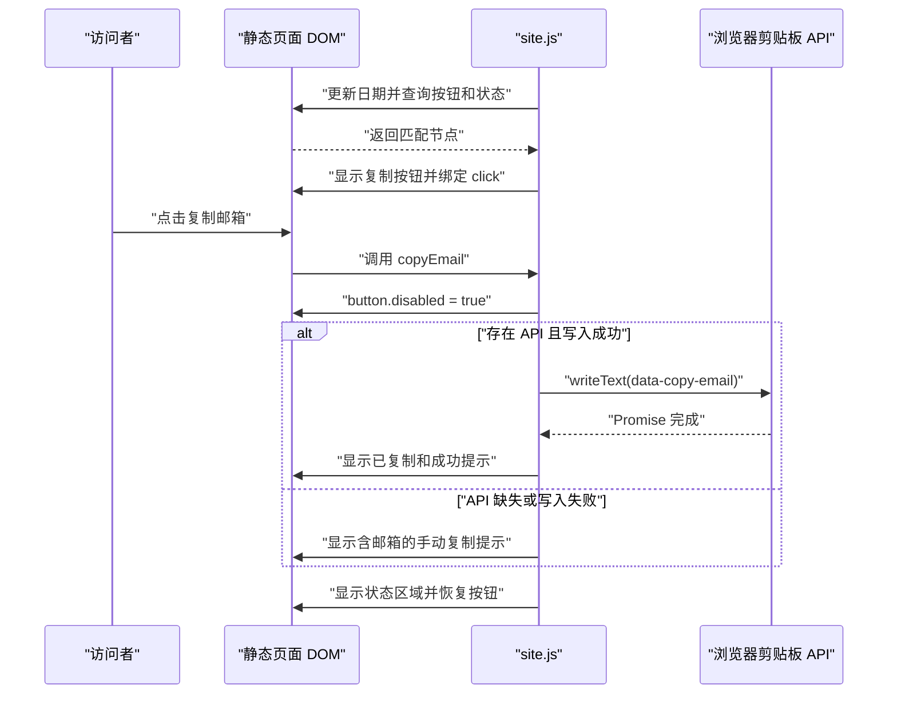
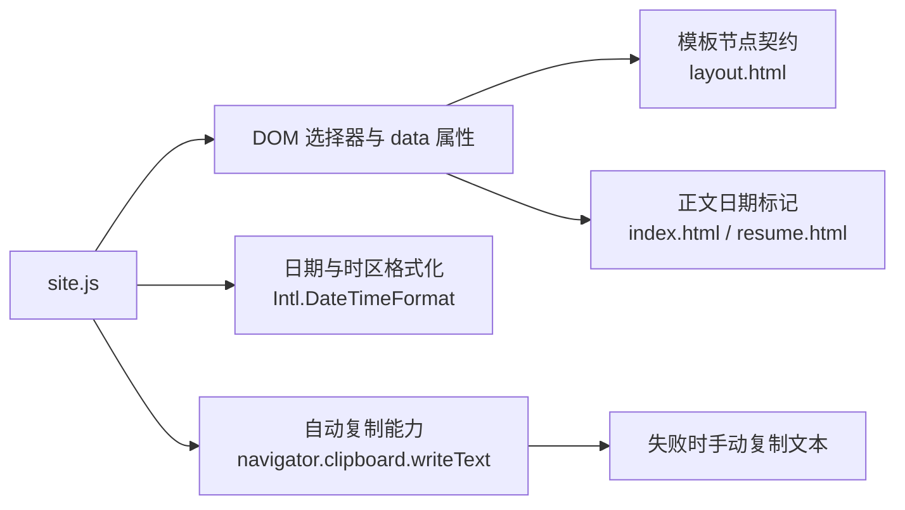

# 渐进增强与无障碍反馈

## 目录
1. [简介](#简介)
2. [项目结构](#项目结构)
3. [核心组件](#核心组件)
4. [架构总览](#架构总览)
5. [详细组件分析](#详细组件分析)
6. [依赖关系分析](#依赖关系分析)
7. [性能与一致性考量](#性能与一致性考量)
8. [故障排查指南](#故障排查指南)
9. [结论](#结论)

## 简介
`site.js` 为生成的静态页面提供日期更新和邮箱复制两类增强，不负责页面路由或正文加载。页面模板预先包含导航、联系方式和可读的日期后备文本，浏览器脚本再通过 `data-*` 属性定位需要更新或交互的节点。复制结果写入共享状态区域，使成功与失败都能给出可见反馈。

- 运行形态：一个立即执行函数，使用原生 DOM 和浏览器 API，没有客户端框架入口。
- 日期口径：构建与浏览器均以 `Asia/Shanghai` 的年月计算年份和近似任职时长。
- 反馈契约：隐藏按钮、`noscript` 邮件链接以及状态区域共同定义增强前后的界面行为。

章节来源
- [site.js:1-43](file://site.js#L1-L43)
- [templates/layout.html:27-51](file://templates/layout.html#L27-L51)
- [build.mjs:30-34](file://build.mjs#L30-L34)

## 项目结构
交互脚本位于仓库根目录，所有页面通过共享布局以 `defer` 引入它。日期标记既分布在布局页脚，也出现在首页和经历页正文中；联系方式则同时存在于页脚和联系页。下面的目录树列出本主题直接涉及的输入文件，构建后它们共同形成根目录 HTML。

```
personalwebsite/
├── site.js
├── build.mjs
└── templates/
    ├── layout.html
    └── pages/
        ├── index.html
        ├── resume.html
        └── contact.html
```

- `site.js`：读取日期标记，绑定复制按钮的点击处理。
- `templates/layout.html`：提供脚本引用、复制按钮、反馈区域和页脚联系链接。
- `templates/pages/`：提供首页年份、任职起始月标记和联系卡片。
- `build.mjs`：提前填入 `YEAR` 与 `EXPERIENCE`，为静态阅读保留后备文本。

结构图展示静态模板与浏览器增强的分工，便于判断一个显示值来自构建还是访问时计算。



脚本围绕已有 HTML 工作，所以查看正文和跟随普通链接无需等待额外的数据请求。

图表来源
- [build.mjs:30-34](file://build.mjs#L30-L34)
- [build.mjs:64-88](file://build.mjs#L64-L88)
- [templates/layout.html:27-51](file://templates/layout.html#L27-L51)
- [site.js:5-20](file://site.js#L5-L20)

章节来源
- [templates/layout.html:27-51](file://templates/layout.html#L27-L51)
- [templates/pages/index.html:3-9](file://templates/pages/index.html#L3-L9)
- [templates/pages/resume.html:8-12](file://templates/pages/resume.html#L8-L12)
- [templates/pages/contact.html:10-19](file://templates/pages/contact.html#L10-L19)
- [build.mjs:30-34](file://build.mjs#L30-L34)

## 核心组件
这套实现可以分为静态交互契约、日期更新和邮箱复制三个组件。静态契约指定可查询的节点与属性，日期更新在初始化阶段直接修改文本，复制处理则只在用户点击时执行异步写入。源码没有插件注册机制，扩展需要同步调整模板标记和脚本选择器。

- 静态契约：`data-current-year`、`data-experience-start` 和 `data-copy-email` 为脚本提供数据入口，`#copy-status` 为交互提供结果出口。
- 日期更新：立即执行函数先计算年月，再对所有日期标记写入 `textContent`。
- 邮箱复制：`copyEmail()` 禁用按钮，等待 `navigator.clipboard.writeText()`，按结果更新按钮与状态文本，最终恢复可点击状态。

脚本为日期使用 `querySelectorAll()`，为按钮和状态使用 `querySelector()`。因此所有日期节点都会更新，而复制逻辑绑定的是第一个匹配按钮及状态节点，并未建立多按钮管理器。

章节来源
- [site.js:5-20](file://site.js#L5-L20)
- [site.js:27-43](file://site.js#L27-L43)
- [templates/layout.html:38-43](file://templates/layout.html#L38-L43)

## 架构总览
初始化时，脚本先更新时间文本，再寻找复制按钮和状态节点。两个节点均存在才显示按钮并注册点击处理；缺少其中之一则提前返回，但已经完成的日期更新不会回滚。下面的时序图追踪一次复制操作，展示成功和失败路径共享的收尾步骤。



成功提示只有在写入 Promise 完成后出现，失败路径则给出可手动选中的邮箱文本，不把失败当作成功。

图表来源
- [site.js:6-20](file://site.js#L6-L20)
- [site.js:27-42](file://site.js#L27-L42)

章节来源
- [site.js:6-20](file://site.js#L6-L20)
- [site.js:22-43](file://site.js#L22-L43)
- [templates/layout.html:38-43](file://templates/layout.html#L38-L43)

## 详细组件分析
浏览器行为取决于模板中的属性与脚本执行顺序，而不是额外的客户端配置文件。日期更新和复制反馈使用同一个立即执行函数，但复制动作具有独立的 `try`、`catch` 和 `finally`。下面分别说明计算口径、DOM 约定和异常处理边界。

章节来源
- [site.js:5-43](file://site.js#L5-L43)
- [templates/layout.html:38-51](file://templates/layout.html#L38-L51)

### 日期与工作时长更新
脚本通过 `Intl.DateTimeFormat('sv-SE', ...)` 获取上海时区的年月，再拆分成数值。所有 `data-current-year` 节点会更新为当年数字，所有 `data-experience-start` 节点按起始年月计算经过的日历月数，未来日期的负差值被钳制为零。展示规则为完整年数加剩余月数，恰好整年时省略零个月，而零时长显示 `0 个月`。

- 更新时机：立即执行函数运行一次，没有定时器持续更新时间。
- 静态后备：构建提前生成 `YEAR` 与 `EXPERIENCE`，脚本不可用时保留这些文本。
- 输入边界：浏览器代码检查起始年份为整数，并检查月份不小于 1、不大于 12；它没有完整校验属性格式、月份整数性或缺失值。
- 配置同步：构建时长从配置的 `workStart` 计算，但经历页的 `data-experience-start` 当前使用写在模板中的固定年月。

任职时长按月近似计算，不使用入职日。若修改工作起始月，只改配置可能造成静态后备文本与浏览器重新计算结果不一致，应同时核对模板属性。

章节来源
- [site.js:6-15](file://site.js#L6-L15)
- [build.mjs:30-34](file://build.mjs#L30-L34)
- [build.mjs:65-65](file://build.mjs#L65-L65)
- [templates/pages/resume.html:8-12](file://templates/pages/resume.html#L8-L12)
- [templates/pages/index.html:3-9](file://templates/pages/index.html#L3-L9)
- [templates/layout.html:48-51](file://templates/layout.html#L48-L51)

### 静态契约与无障碍反馈
复制控件是原生 `<button type="button">`，初始带有 `hidden`，只有脚本成功找到按钮与状态区域后才显示。按钮的 `aria-describedby="copy-status"` 关联反馈段落，后者声明 `role="status"` 和 `aria-live="polite"`，并在操作结束后解除隐藏。源码配置了这些语义属性，但没有记录跨浏览器或辅助技术的验证结果，不能据此声称所有环境下体验完全一致。

- JavaScript 被禁用时，`noscript` 中的 `mailto:` 链接提供邮件联系入口。
- 页脚和联系页本来就包含邮件、电话链接与可见联系文本。
- 导航通过普通 `<a>` 链接工作，脚本不拦截跳转。
- 状态区开始为空并隐藏，复制完成后由 `finally` 显示结果。

`noscript` 回退取决于脚本是否被禁用，不代表脚本加载失败或运行异常时一定会显示。即便增强按钮未出现，页脚与联系页已有的静态联系入口仍保存在 HTML 中。

章节来源
- [templates/layout.html:33-51](file://templates/layout.html#L33-L51)
- [templates/pages/contact.html:10-19](file://templates/pages/contact.html#L10-L19)
- [site.js:17-20](file://site.js#L17-L20)
- [site.js:37-42](file://site.js#L37-L42)

### 复制操作与失败边界
`copyEmail()` 在任何剪贴板检查之前先禁用按钮，使同一按钮不会在等待期间重复触发用户点击。若 API 不存在，代码主动抛出错误；若写入 Promise 拒绝，同样进入 `catch`，按钮恢复为“复制邮箱”，状态文本显示手动复制提示。成功路径把按钮改为“已复制”，并写入成功提示，随后 `finally` 显示状态并重新启用按钮。

- 输入来源：读取按钮的 `dataset.copyEmail`，不发起网络请求，也不从页面文本反向解析邮箱。
- 成功条件：等待 `writeText()` 完成，不只检查 API 是否存在。
- 失败回退：通过 `textContent` 输出邮箱文本，没有自动打开邮件客户端。
- 收尾规则：无论成功或失败，都恢复按钮的 `disabled` 状态；成功后的按钮文案会保留到后续操作更新它。

剪贴板错误处理只覆盖 `copyEmail()` 内部的操作。日期初始化或 DOM 查询之前的异常没有外围 `catch`，可能使后续按钮注册无法执行；源码也没有错误上报或自动重试机制。

章节来源
- [site.js:5-20](file://site.js#L5-L20)
- [site.js:22-43](file://site.js#L22-L43)
- [templates/layout.html:38-43](file://templates/layout.html#L38-L43)

## 依赖关系分析
运行时增强只依赖页面 DOM、日期格式化能力和剪贴板 API，没有额外库依赖。页面的基础浏览与联系链接先由静态 HTML 提供，剪贴板能力缺失则在用户点击后转换为手动复制反馈。源码没有给出浏览器最低版本，下面仅按具体功能所需的能力说明依赖。

- 必选：DOM 查询、事件绑定与 `textContent` 支撑脚本定位和更新节点；匹配的按钮与状态节点是复制绑定的结构要求。
- 必选：`Intl.DateTimeFormat`、`Date` 和上海时区选项支撑初始化日期计算。
- 可选：`navigator.clipboard.writeText` 支撑自动复制，缺失或失败由交互处理函数回退。

依赖图展示同一脚本对不同能力的消费位置，便于分辨初始化失败与某次点击失败。



缺少剪贴板能力可以进入已有回退流程，日期初始化异常则可能阻断后续复制按钮的显示和绑定。

图表来源
- [site.js:6-20](file://site.js#L6-L20)
- [site.js:27-40](file://site.js#L27-L40)
- [templates/layout.html:38-43](file://templates/layout.html#L38-L43)
- [templates/pages/resume.html:8-12](file://templates/pages/resume.html#L8-L12)
- [templates/pages/index.html:3-9](file://templates/pages/index.html#L3-L9)

章节来源
- [site.js:5-43](file://site.js#L5-L43)
- [templates/layout.html:27-43](file://templates/layout.html#L27-L43)
- [templates/pages/resume.html:8-12](file://templates/pages/resume.html#L8-L12)
- [templates/pages/index.html:3-9](file://templates/pages/index.html#L3-L9)

## 性能与一致性考量
脚本在初始化时格式化一次日期并遍历相应节点，复制时才调用异步剪贴板能力。实现没有轮询、客户端数据缓存或网络获取流程，性能成本主要是少量 DOM 查询与文本更新。构建与运行时使用相同的时区和月差公式，但数据来源仍需维护者保持一致。

- 初始化成本：日期节点使用集合遍历，复制控件只查询一次，监听器只绑定一次。
- 交互并发：等待复制时禁用同一按钮，完成后恢复；代码没有跨标签页协调机制。
- 时间一致性：静态 HTML 展示构建时的年份与任职时长，脚本运行后展示访问时的年月；页面长期打开不会自动跨月更新。
- 源数据一致性：配置的 `workStart` 与正文模板中的 `data-experience-start` 应同步，避免增强前后时长跳变。

源码未包含基准测试或浏览器兼容性结果，因此这里的性能描述只依据操作数量和控制流，不给出未经测量的响应时间。

章节来源
- [site.js:6-20](file://site.js#L6-L20)
- [site.js:27-43](file://site.js#L27-L43)
- [build.mjs:30-34](file://build.mjs#L30-L34)
- [templates/pages/resume.html:8-12](file://templates/pages/resume.html#L8-L12)

## 故障排查指南
先确认静态 HTML 是否包含预期节点，再检查脚本初始化是否完成，最后观察某次点击的反馈路径。日期与复制初始化处于同一个函数，早期异常可能解释按钮始终隐藏。对于复制失败，页面已经提供手动复制文本，排查时应保留这一回退能力。

- 复制按钮不显示：确认 `site.js` 已加载且无初始化异常，再检查 `[data-copy-email]` 和 `#copy-status` 是否同时存在；任一节点缺失都会在显示按钮前返回。
- 点击后出现手动复制提示：说明 API 不存在或写入抛错/拒绝，定位 `writeText` 调用与浏览器控制台；此提示是预期失败分支，静态邮件链接仍可使用。
- 按钮一直禁用且无反馈：检查异步写入是否仍在等待以及运行错误；正常成功或捕获到的失败都会经过 `finally` 恢复按钮。
- 任职时长更新异常：检查 `data-experience-start` 的年月格式，并与配置的起始月比较；当前浏览器校验不覆盖全部异常输入。
- 禁用脚本后年份仍旧：这是构建后备文本，检查是否重新生成 HTML；源码没有纯 HTML 的自动日期更新能力。
- 状态反馈未按预期被读取：检查 `aria-describedby` 指向的 ID、状态区的 `role`、`aria-live` 和 `hidden`；相关环境仍需实际验证。

章节来源
- [site.js:6-20](file://site.js#L6-L20)
- [site.js:27-40](file://site.js#L27-L40)
- [templates/layout.html:27-51](file://templates/layout.html#L27-L51)
- [templates/pages/resume.html:8-12](file://templates/pages/resume.html#L8-L12)
- [build.mjs:30-34](file://build.mjs#L30-L34)

## 结论
这套增强让静态作品集在访问时获得新的日期文本和带结果反馈的邮箱复制操作。维护时应同时核对模板节点、日期属性和脚本选择器，复制失败则保留可读的手动操作提示。已有实现提供了清晰的回退分支与语义标记，其输入校验和环境兼容性仍应按源码实际边界理解。

章节来源
- [site.js:1-43](file://site.js#L1-L43)
- [templates/layout.html:38-51](file://templates/layout.html#L38-L51)
- [templates/pages/resume.html:8-12](file://templates/pages/resume.html#L8-L12)
- [templates/pages/contact.html:10-19](file://templates/pages/contact.html#L10-L19)

<cite>
**本文引用的文件**
- [site.js](file://site.js)
- [layout.html](file://templates/layout.html)
- [contact.html](file://templates/pages/contact.html)
- [resume.html](file://templates/pages/resume.html)
- [index.html](file://templates/pages/index.html)
- [build.mjs](file://build.mjs)
</cite>
