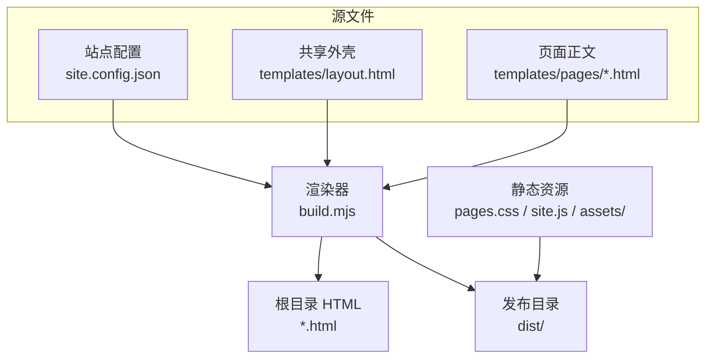
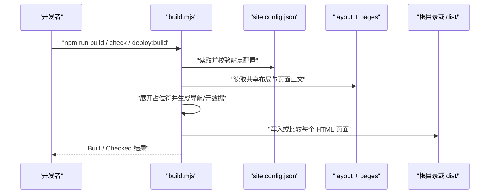
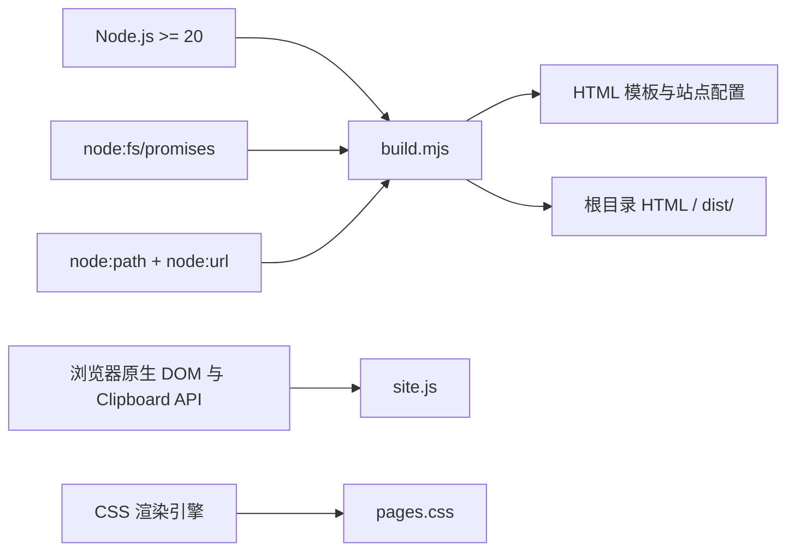

# 开发与构建

## 目录
1. [简介](#简介)
2. [项目结构](#项目结构)
3. [核心组件](#核心组件)
4. [架构总览](#架构总览)
5. [详细组件分析](#详细组件分析)
6. [依赖关系分析](#依赖关系分析)
7. [性能与一致性考量](#性能与一致性考量)
8. [故障排查指南](#故障排查指南)
9. [结论](#结论)

## 简介
本仓库是一个无框架、无构建依赖的静态作品集站点。开发时维护配置、共享布局和页面正文，`build.mjs` 将它们展开为根目录 HTML；发布构建则把同一套页面及资源复制到 `dist/`。运行环境要求 Node.js 20 或以上，仓库明确不需要先执行 `npm install`。

- 页面语言与站点文案以简体中文为主，生成器使用原生 Node.js 模块。
- `site.config.json` 集中维护导航、标题、摘要和公开联系方式，模板负责结构。
- 根目录 HTML 是提交给现有 Pages 根目录发布的生成结果，`dist/` 是部署构建产物。

章节来源
- [README.md:1-7](file://README.md#L1-L7)
- [package.json:1-10](file://package.json#L1-L10)

## 项目结构
与开发和构建有关的文件边界如下：

```text
.
├── site.config.json        # 站点信息、页面清单和公开联系方式
├── templates/
│   ├── layout.html         # 全站 HTML 外壳
│   └── pages/              # 各页面正文模板
├── build.mjs               # 校验、渲染、检查和部署复制
├── pages.css               # 共享样式
├── site.js                 # 浏览器端渐进增强
├── assets/                 # 截图、图标和分享预览
├── *.html                  # 提交到根目录的生成页面
└── dist/                   # --deploy 生成的发布目录
```

`templates/` 是源文件边界，根目录的 HTML 不应直接手工编辑。`build.mjs` 在普通模式写入根目录，在部署模式先重建 `dist/`，再复制样式、脚本与图片；因此新增页面通常需要先改配置和正文模板，再运行构建。



图表来源
- [README.md:3-7](file://README.md#L3-L7)
- [build.mjs:15-18](file://build.mjs#L15-L18)
- [build.mjs:90-93](file://build.mjs#L90-L93)

章节来源
- [README.md:3-7](file://README.md#L3-L7)
- [build.mjs:15-18](file://build.mjs#L15-L18)
- [build.mjs:90-93](file://build.mjs#L90-L93)

## 核心组件
下表按“谁提供输入、谁负责生成、谁承载结果”的顺序阅读，可以快速定位一次页面修改需要触及的文件。

| 组件 | 关键文件 | 一句话职责 |
| --- | --- | --- |
| 站点配置 | `site.config.json` | 提供身份信息、日期基准、页面元数据和导航清单。 |
| 共享外壳 | `templates/layout.html` | 定义头部、导航、 SEO 分享标签、正文插槽和页脚。 |
| 页面正文 | `templates/pages/*.html` | 保存各页面的业务文案、区块和案例图片引用。 |
| 构建脚本 | `build.mjs` | 校验配置，展开占位符，写入根目录或 `dist/`。 |
| 运行时增强 | `site.js`、`pages.css` | 提供日期更新、复制邮箱、布局和响应式表现。 |

构建器没有插件注册点或外部构建框架；可定制位置集中在 JSON 配置、布局模板和页面正文模板。页面清单新增文件后，生成器会从 `templates/pages/` 读取同名正文，并为每页自动生成导航和元数据。

章节来源
- [build.mjs:17-29](file://build.mjs#L17-L29)
- [build.mjs:64-78](file://build.mjs#L64-L78)
- [templates/layout.html:1-27](file://templates/layout.html#L1-L27)
- [package.json:4-9](file://package.json#L4-L9)

## 架构总览
构建过程是一次从配置与模板到静态文件的确定性转换。脚本先读取配置和共享布局，验证 URL、日期与页面清单，再对每页正文展开占位符；普通构建直接写根目录，`--check` 比较现有文件，`--deploy` 则把页面和资源放入受保护的 `dist/` 目录。

下面的时序图强调一次构建调用中各输入的读取顺序，以及检查和写入在同一渲染循环中的分支。



图表来源
- [package.json:4-9](file://package.json#L4-L9)
- [build.mjs:10-34](file://build.mjs#L10-L34)
- [build.mjs:64-88](file://build.mjs#L64-L88)

章节来源
- [build.mjs:10-34](file://build.mjs#L10-L34)
- [build.mjs:64-95](file://build.mjs#L64-L95)
- [templates/layout.html:29-52](file://templates/layout.html#L29-L52)

## 详细组件分析
本页相关子主题的职责索引如下；子主题之间通过构建器传递字符串和文件，而不是通过运行时模块导入连接。

| 子页 | 核心实体/机制 | 一句话职责 |
| --- | --- | --- |
| 配置与页面 | 页面清单、占位符值 | 决定站点身份、页面数量及每页元数据。 |
| 交互与样式 | CSS、浏览器 JavaScript | 负责视觉系统、响应式布局与渐进增强。 |
| 部署与维护 | `--deploy`、检查命令 | 负责生成发布目录并防止源文件与产物漂移。 |

### 配置与页面
`build.mjs` 将配置中的站点值转换为 `NAME`、`ROLE`、`PHONE`、`EMAIL`、`WORK_START`、`YEAR` 和 `EXPERIENCE` 等模板值。每个页面必须有唯一的 `.html` 文件名，以及非空的 `label`、`icon`、`title` 和 `description`；`index.html` 是强制入口。

构建循环读取 `templates/pages/<file>`，根据当前页面标记导航项，并将标题、描述、规范 URL、分享图片和正文插入布局。配置文本先经过 HTML 转义，正文只展开有限的命名占位符，未知占位符会让构建失败。

章节来源
- [build.mjs:17-29](file://build.mjs#L17-L29)
- [build.mjs:40-55](file://build.mjs#L40-L55)
- [build.mjs:64-78](file://build.mjs#L64-L78)

### 构建输出
普通 `build` 模式将每个页面写回仓库根目录，便于兼容现有 Pages 根目录发布。`--deploy` 模式只允许清空固定的 `dist/` 目录，重新创建目录后写入页面，并复制 `pages.css`、`site.js` 和 `assets`；`--check` 不写文件，只将生成结果与已存在的页面比较。

这种输出策略把可审阅的生成 HTML 与可上传的部署目录分开。维护者应先改模板或配置，再执行 `npm run build`，需要发布时执行 `npm run deploy:build`，而提交前可运行 `npm run check` 发现漂移。

章节来源
- [README.md:3-7](file://README.md#L3-L7)
- [build.mjs:57-62](file://build.mjs#L57-L62)
- [build.mjs:79-93](file://build.mjs#L79-L93)

### 模板外壳
共享布局使用 `{{...}}` 占位符承接构建值，固定输出文档类型、中文语言、描述和 Open Graph/Twitter 分享标签。正文通过 `{{CONTENT}}` 插入，导航通过 `{{NAV}}` 插入，页脚同时保留电话和邮件链接。

布局还加载 `pages.css` 与延迟执行的 `site.js`，并提供无 JavaScript 时的 `mailto:` 链接。这样页面的静态内容和可访问联系入口由生成 HTML 直接承载，交互增强不会成为首屏渲染的唯一来源。

章节来源
- [templates/layout.html:1-27](file://templates/layout.html#L1-L27)
- [templates/layout.html:29-52](file://templates/layout.html#L29-L52)

## 依赖关系分析
运行时依赖保持在 Node.js 内置模块和浏览器原生能力范围内。`package.json` 只声明 Node.js 版本门槛与三个脚本命令；构建脚本使用 `node:fs/promises`、`node:path` 和 `node:url`，不需要安装第三方包。



图表来源
- [package.json:4-9](file://package.json#L4-L9)
- [build.mjs:6-8](file://build.mjs#L6-L8)
- [site.js:1-26](file://site.js#L1-L26)

章节来源
- [package.json:1-10](file://package.json#L1-L10)
- [build.mjs:6-8](file://build.mjs#L6-L8)
- [templates/layout.html:23-27](file://templates/layout.html#L23-L27)

## 性能与一致性考量
构建器按页面清单顺序串行读取和写入文件，页面数量有限时流程简单且结果可重复。发布构建会先清空并重建固定的 `dist/`，从而避免旧页面或旧资源残留；`--check` 则把生成结果作为一致性基线。

- 配置值在写入属性和文本前统一进行 HTML 转义，降低特殊字符破坏标记的风险。
- 构建时按 `Asia/Shanghai` 计算年份和任职月数，浏览器端再按同一时区更新动态后备文本。
- `render` 只接受大写命名占位符，缺失键立即抛错；这会把模板拼写错误提前暴露在发布前。
- `dist` 路径在清空前核对目录边界，避免部署参数意外指向仓库根目录。

章节来源
- [build.mjs:30-34](file://build.mjs#L30-L34)
- [build.mjs:36-55](file://build.mjs#L36-L55)
- [build.mjs:57-62](file://build.mjs#L57-L62)
- [build.mjs:82-85](file://build.mjs#L82-L85)

## 故障排查指南
排查时先确认命令、Node.js 版本和模板/配置的修改是否符合生成器校验，再根据错误发生在配置读取、模板渲染还是输出比较阶段定位文件。

- **运行命令立即失败** → 原因可能是传入了未知参数或同时传入 `--check` 与 `--deploy` → 先查看 `Usage: node build.mjs [--check | --deploy]`，每次只选择一种模式 → 相关位置为 `build.mjs` 的参数检查。
- **提示页面字段缺失或 `index.html` 不存在** → 原因是 `site.config.json` 页面对象字段为空、文件名重复或入口缺失 → 检查页面清单中的 `file`、`label`、`icon`、`title`、`description`，再重新运行构建 → 相关位置为配置验证循环。
- **提示 `needs rebuilding`** → 原因是根目录 HTML 与当前模板、配置或月份后备文本不一致 → 先运行 `npm run build` 更新生成文件，再用 `npm run check` 复核 → 相关位置为 `--check` 分支。
- **部署后页面或资源缺失** → 原因是只上传了源目录或未执行部署构建 → 使用 `npm run deploy:build`，确认 `dist/` 同时包含 HTML、样式、脚本和 `assets/` → 相关位置为 `--deploy` 复制逻辑。

章节来源
- [build.mjs:11-14](file://build.mjs#L11-L14)
- [build.mjs:19-29](file://build.mjs#L19-L29)
- [build.mjs:79-93](file://build.mjs#L79-L93)

## 结论
开发时把配置、布局和正文模板视为唯一源文件，使用 `npm run build` 生成根目录页面；用 `npm run check` 检查漂移，用 `npm run deploy:build` 准备 `dist/` 发布目录。该流程通过原生 Node.js 完成，适合页面数量有限、需要静态输出和可审阅生成结果的作品集站点。

章节来源
- [README.md:3-7](file://README.md#L3-L7)
- [package.json:4-9](file://package.json#L4-L9)
- [build.mjs:90-95](file://build.mjs#L90-L95)

<cite>
**本文引用的文件**
- [README.md](file://README.md)
- [package.json](file://package.json)
- [build.mjs](file://build.mjs)
- [templates/layout.html](file://templates/layout.html)
- [site.js](file://site.js)
</cite>
