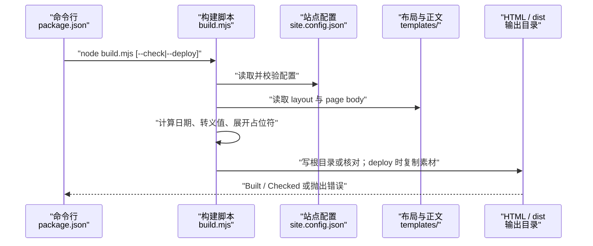
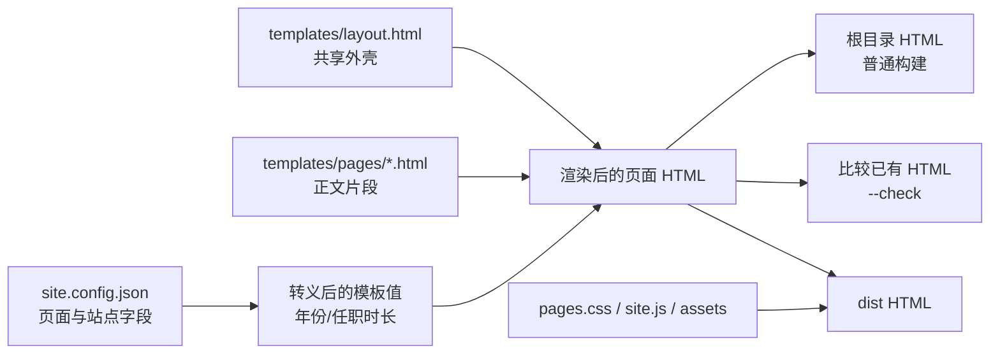

# 模板渲染与构建流程

## 目录
1. [简介](#简介)
2. [流程总览](#流程总览)
3. [关键步骤](#关键步骤)
4. [参与组件](#参与组件)
5. [数据与状态变化](#数据与状态变化)
6. [故障排查指南](#故障排查指南)
7. [结论](#结论)

## 简介

这是仓库把站点配置和 HTML 模板转换成可发布页面的确定性构建流程。它由 `node build.mjs` 触发，默认把八个页面写回仓库根目录；`--check` 只比较已有页面，`--deploy` 则清理并填充 `dist`。构建脚本同时负责配置校验、上海时区的年份与任职时长后备文本、模板占位符替换和部署素材复制。

章节来源
- [build.mjs:1-18](file://build.mjs#L1-L18)
- [package.json:4-9](file://package.json#L4-L9)

## 流程总览

流程起点是 npm script 调用 `build.mjs`，脚本读取 `site.config.json`、共享布局和当前页面正文；中间经过配置校验、值转义、导航与元信息组装，终点是写入根目录 HTML、核对已有 HTML，或将发布资源复制到 `dist`。每个页面独立读取和渲染，因此一个页面正文出错会使整个构建在写出该页面前失败。

图表来源
- [package.json:4-9](file://package.json#L4-L9)
- [build.mjs:15-21](file://build.mjs#L15-L21)
- [build.mjs:64-95](file://build.mjs#L64-L95)

图中只有构建脚本写入输出，模板和配置保持输入角色；不同模式共享前半段的校验与渲染逻辑。

章节来源
- [build.mjs:15-21](file://build.mjs#L15-L21)
- [build.mjs:64-95](file://build.mjs#L64-L95)

## 关键步骤

### 步骤 1：解析模式与输入

输入是最多一个 `--check` 或 `--deploy` 标志；没有标志时代表普通构建。脚本把自身文件所在目录作为仓库根目录，再读取 JSON 配置和共享布局，因此从其他工作目录调用仍会针对脚本所在仓库工作。未知参数或同时传入两个模式会立即抛出用法错误。

- 输入：`package.json` 中的命令或直接运行 `node build.mjs`。
- 处理：`flags` 只允许 `--check`、`--deploy`；`output` 在部署模式下固定为根目录下的 `dist`。
- 失败路径：标志非法或模式冲突时在读取配置前终止，不会清理或写出产物。

章节来源
- [build.mjs:6-18](file://build.mjs#L6-L18)
- [package.json:4-9](file://package.json#L4-L9)

### 步骤 2：校验站点配置与页面清单

脚本要求站点 URL 是以 `/` 结尾的绝对 HTTP(S) URL，`workStart` 使用 `YYYY-MM`，页面数组非空。随后检查每个页面文件是根目录下的 `.html` 文件、文件名不重复、元数据字段齐全，并要求清单含有 `index.html`；这些规则把配置错误变成发布前的明确失败。

- 输入：`site.config.json` 的站点字段和 `pages` 数组。
- 处理：建立 `pageFiles` 集合，逐页验证 `file`、`label`、`icon`、`title`、`description`。
- 失败路径：正则、重复文件、缺少字段或缺少首页都会抛出 `Error`，循环尚未开始写页面。

章节来源
- [build.mjs:17-29](file://build.mjs#L17-L29)
- [site.config.json:1-17](file://site.config.json#L1-L17)

### 步骤 3：计算动态值并安全展开模板

脚本按 `Asia/Shanghai` 得到当前年月，再以配置中的起始月计算月数和可读的年/月文本。每个配置标量先经过 `escapeHtml`，布局和正文分别通过 `render` 展开大写占位符；占位符缺少对应值会抛错，从而暴露模板拼写错误。导航由同一页面清单生成，当前页面附加 `aria-current`，页面 URL、分享图和首页特殊 class 也在这里注入。

- 输入：配置标量、页面元数据、`templates/layout.html` 与对应 `templates/pages/*.html`。
- 处理：转义 HTML 特殊字符，组装 `TITLE`、`DESCRIPTION`、`URL`、`IMAGE`、`NAV`、`CONTENT` 等值。
- 失败路径：缺少模板值会在 `render` 中终止；模板文件读取失败也会阻断当前页面生成。

章节来源
- [build.mjs:30-55](file://build.mjs#L30-L55)
- [build.mjs:64-78](file://build.mjs#L64-L78)
- [templates/layout.html:7-27](file://templates/layout.html#L7-L27)

### 步骤 4：写入、核对或准备部署产物

脚本为每个页面解析目标路径，并确认目标仍位于选定输出目录下。普通模式写入根目录；`--check` 读取已有文件，将 CRLF 归一化后与预期 HTML 比较；`--deploy` 先安全地清空固定 `dist` 目录，再在页面完成后复制 `pages.css`、`site.js` 和 `assets`。循环结束打印当前年月和页面数量。

- 输入：已经渲染的 HTML 字符串与选定 `output`。
- 处理：逐页 `writeFile` 或比较现有文件；部署模式最后复制静态资源。
- 失败路径：目标越出输出目录、现有 HTML 漂移或部署目录边界异常时抛错；没有成功构建就不会出现成功日志。

章节来源
- [build.mjs:57-62](file://build.mjs#L57-L62)
- [build.mjs:79-95](file://build.mjs#L79-L95)

## 参与组件

这些组件按“配置决定页面集合、模板决定结构、脚本决定生成策略、输出目录承担发布”协作。页面正文保持内容，`layout.html` 提供共享外壳，而 `build.mjs` 是唯一把二者绑定到目标文件的执行入口。

- `package.json`：公开 `build`、`check`、`deploy:build` 三个命令，并声明 Node.js `>=20`。
- `site.config.json`：保存品牌、联系方式、工作起始月、页面文件名和 SEO 描述。
- `templates/layout.html`：定义 head 元数据、导航、复制邮箱按钮、正文槽位和页脚。
- `templates/pages/*.html`：提供每个页面的正文片段；例如首页包含能力概览和三个入口卡片。
- `build.mjs`：完成校验、日期计算、转义、占位符展开、输出比较与部署资源复制。
- `pages.css`、`site.js`、`assets/`：仅在 `--deploy` 结束时整体复制到 `dist`。

章节来源
- [package.json:4-9](file://package.json#L4-L9)
- [site.config.json:1-17](file://site.config.json#L1-L17)
- [templates/layout.html:29-53](file://templates/layout.html#L29-L53)
- [templates/pages/index.html:1-85](file://templates/pages/index.html#L1-L85)
- [build.mjs:64-95](file://build.mjs#L64-L95)

## 数据与状态变化

一次构建不会维护持久化状态机，而是把输入文件映射成一组 HTML 文件。输入中的 `workStart` 被转换为当前年月、月数和展示文本；页面配置被转换为导航项、元标签和目标文件；`--check` 只读比较，`--deploy` 则产生干净的 `dist` 快照。

图表来源
- [build.mjs:30-34](file://build.mjs#L30-L34)
- [build.mjs:64-92](file://build.mjs#L64-L92)
- [templates/layout.html:45-52](file://templates/layout.html#L45-L52)

图中的三个输出分支由命令标志选择：检查模式不写 HTML，部署模式把页面和静态资源汇合到同一发布目录。

章节来源
- [build.mjs:30-34](file://build.mjs#L30-L34)
- [build.mjs:64-92](file://build.mjs#L64-L92)
- [site.config.json:7-17](file://site.config.json#L7-L17)

## 故障排查指南

排查时先确认命令模式和配置，再定位是模板输入、生成内容还是输出比较失败。错误都来自同步的 `throw new Error` 或文件读写结果，因此应先看终端中的具体文件名和字段名，再回到对应源文件修复并重新运行相同命令。

- **现象：提示 `Usage` 或未知参数。** 原因是同时传入 `--check` 与 `--deploy`，或传入了其他标志。定位步骤：检查 `package.json` script 和实际命令，只保留一个受支持模式；代码位置为 `build.mjs:11-16`。
- **现象：提示 URL、`workStart`、页面字段或 `index.html` 错误。** 原因是 `site.config.json` 不满足校验约束。定位步骤：逐项检查 `url` 末尾斜线、`YYYY-MM`、文件唯一性和四个页面描述字段；代码位置为 `build.mjs:19-29`。
- **现象：提示 `Unknown template value`。** 原因是布局或正文写了脚本没有提供的大写占位符。定位步骤：搜索 `{{...}}`，让模板键与 `build.mjs:69-77` 的 values 对齐；不要把动态 HTML 直接拼进未转义配置值。
- **现象：`--check` 报某个页面 `needs rebuilding`。** 原因是根目录 HTML 与当前模板、配置或月份后备文本不一致。定位步骤：先运行 `node build.mjs` 重建，再运行 `npm run check`；代码位置为 `build.mjs:82-85`。
- **现象：部署产物缺少 CSS、脚本或图片。** 原因是只做了普通构建，未执行 `--deploy` 的资源复制。定位步骤：运行 `npm run deploy:build`，检查 `dist` 中的三个资源入口；代码位置为 `build.mjs:90-92`。

章节来源
- [build.mjs:11-16](file://build.mjs#L11-L16)
- [build.mjs:19-29](file://build.mjs#L19-L29)
- [build.mjs:50-54](file://build.mjs#L50-L54)
- [build.mjs:82-92](file://build.mjs#L82-L92)

## 结论

该流程适合页面数量有限、源文件需要可审查且发布产物应可重复生成的静态站。维护时应编辑 `site.config.json`、`templates/` 或资源源文件，然后先普通构建验证页面，再按需要运行 `npm run check` 或 `npm run deploy:build`；不要把根目录生成 HTML 当作模板源文件修改。

章节来源
- [README.md:1-11](file://README.md#L1-L11)
- [build.mjs:1-4](file://build.mjs#L1-L4)
- [package.json:4-9](file://package.json#L4-L9)

<cite>
**本文引用的文件**
- [build.mjs](file://build.mjs)
- [site.config.json](file://site.config.json)
- [templates/layout.html](file://templates/layout.html)
- [templates/pages/index.html](file://templates/pages/index.html)
- [package.json](file://package.json)
- [README.md](file://README.md)
</cite>
