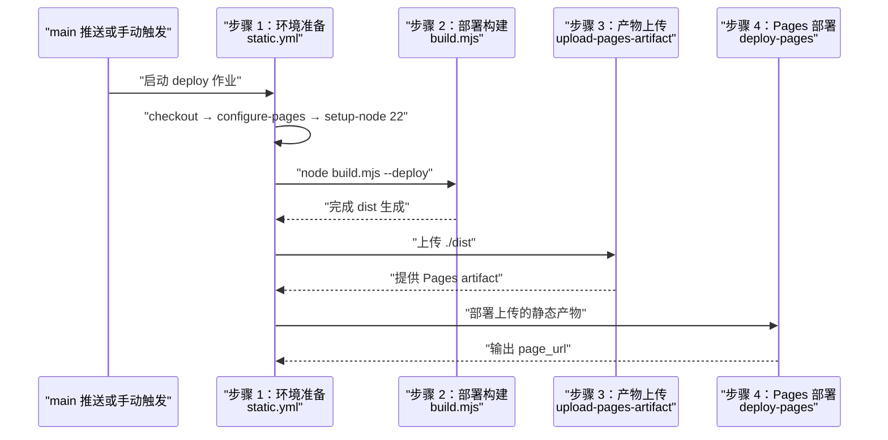
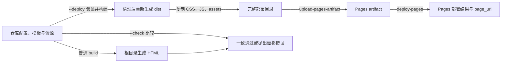

# Pages 发布与一致性校验

## 目录
1. [简介](#简介)
2. [流程总览](#流程总览)
3. [关键步骤](#关键步骤)
4. [参与组件](#参与组件)
5. [数据与状态变化](#数据与状态变化)
6. [故障排查指南](#故障排查指南)
7. [结论](#结论)

## 简介
仓库通过 `.github/workflows/static.yml` 将静态站点发布到 GitHub Pages，触发条件为推送到 `main` 或手动执行 `workflow_dispatch`。工作流在 Ubuntu 环境准备 Pages 与 Node.js，运行部署构建，再上传 `dist` 并执行部署。维护者还可以在本地运行 `--check` 比较源模板生成结果与已提交的根目录 HTML，但该检查命令未作为当前发布工作流的一步执行。

章节来源
- [.github/workflows/static.yml:1-48](file://.github/workflows/static.yml#L1-L48)
- [package.json:4-9](file://package.json#L4-L9)
- [build.mjs:79-88](file://build.mjs#L79-L88)
- [README.md:5-7](file://README.md#L5-L7)

## 流程总览
一次发布从 `main` 推送或手动触发开始，进入唯一的 `deploy` 作业。该作业依次检出源码、配置 Pages、准备 Node.js 22、生成部署产物，然后上传 `dist` 并部署至 `github-pages` 环境。流程没有在构建与部署之间引入服务器或数据库，输出站点由静态文件组成。

下面的时序图按工作流真实顺序展示四个阶段，便于把失败日志对应到环境、构建、上传或部署。

当前发布消费的是本次构建得到的 `dist`，根目录 HTML 的一致性检查需要维护者另行运行。

图表来源
- [.github/workflows/static.yml:4-10](file://.github/workflows/static.yml#L4-L10)
- [.github/workflows/static.yml:24-48](file://.github/workflows/static.yml#L24-L48)
- [build.mjs:15-18](file://build.mjs#L15-L18)
- [build.mjs:57-94](file://build.mjs#L57-L94)

章节来源
- [.github/workflows/static.yml:4-48](file://.github/workflows/static.yml#L4-L48)
- [build.mjs:57-94](file://build.mjs#L57-L94)
- [package.json:4-7](file://package.json#L4-L7)

## 关键步骤
这四个步骤对应流程图中的环境准备、部署构建、产物上传和 Pages 部署。配置、模板和生成文件之间的一致性检查是构建器的另一个模式，列在构建步骤中说明其使用边界。当前工作流没有定义自动重试或允许构建失败后继续上传的设置。

章节来源
- [.github/workflows/static.yml:31-48](file://.github/workflows/static.yml#L31-L48)
- [build.mjs:11-16](file://build.mjs#L11-L16)
- [build.mjs:79-88](file://build.mjs#L79-L88)

### 步骤 1：准备环境与并发约束
作业运行在 `ubuntu-latest`，依次调用 `actions/checkout@v4`、`actions/configure-pages@v5` 和 `actions/setup-node@v4`。Node.js 版本被指定为 22，高于项目在 `package.json` 声明的最低版本 20。构建使用 Node.js 内置模块，工作流没有安装依赖的步骤。

- 输入：触发此次运行的仓库内容与 Pages 设置。
- 权限：`GITHUB_TOKEN` 声明 `contents: read`、`pages: write` 和 `id-token: write`，分别提供读取仓库与 Pages 部署相关能力。
- 并发：全工作流使用 `group: "pages"` 和 `cancel-in-progress: false`，避免主动取消正在进行的发布；配置注释说明保留最新排队运行的意图。
- 失败路径：环境准备动作失败会使后续部署无法顺利完成，定位对应动作日志；源码没有额外重试配置。

环境声明使用 `github-pages` 名称，并引用部署步骤输出的 `page_url` 作为环境地址。此文件描述了执行配置，没有证明任何一次远程部署已经成功。

章节来源
- [.github/workflows/static.yml:12-39](file://.github/workflows/static.yml#L12-L39)
- [package.json:9-9](file://package.json#L9-L9)
- [build.mjs:6-8](file://build.mjs#L6-L8)
- [README.md:3-5](file://README.md#L3-L5)

### 步骤 2：构建部署目录与检查根目录一致性
发布工作流实际执行 `node build.mjs --deploy`，与 `npm run deploy:build` 的脚本定义等价。构建器以自身文件位置确定仓库根目录，验证配置，读取布局和正文模板，再逐页生成 HTML。部署模式先核对固定输出边界，再清空并重建 `dist`，最后复制 `pages.css`、`site.js` 和整个 `assets` 目录。

- 输入：`site.config.json`、共享布局、逐页模板及静态资源。
- 输出：配置页面清单对应的 HTML、样式、浏览器脚本和 `assets` 素材；模板目录、构建源码和配置文件没有进入复制清单。
- 失败路径：未知参数、非法配置、缺失模板、未知占位符或文件读写失败会抛出错误，阻止构建正常结束。
- 幂等边界：每次部署构建重新清理固定 `dist`；普通构建写入根目录 HTML，但不会执行这一步目录清理。

`--check` 是独立模式，不能与 `--deploy` 同时指定。它重新计算当前上海时区年月下的 HTML，将现有文件的 CRLF 转为 LF 后比较，发现不一致或目标文件缺失时抛出 `needs rebuilding` 错误；它不写入新 HTML。检查验证生成结果是否一致，不验证视觉排版、外链可用性、浏览器交互或图片文件完整性。

章节来源
- [.github/workflows/static.yml:40-41](file://.github/workflows/static.yml#L40-L41)
- [package.json:4-7](file://package.json#L4-L7)
- [build.mjs:10-34](file://build.mjs#L10-L34)
- [build.mjs:50-61](file://build.mjs#L50-L61)
- [build.mjs:64-95](file://build.mjs#L64-L95)

### 步骤 3：上传静态产物
上传步骤调用 `actions/upload-pages-artifact@v3`，输入路径明确为 `./dist`。因此上传范围由部署构建的输出目录决定，不会直接把整个仓库作为站点内容上传。工作流没有配置额外的产物转换或自定义保留时间。

- 输入：前一步成功生成的部署目录。
- 处理：将 `./dist` 交给 Pages artifact 上传动作。
- 失败定位：若上传阶段报目录或产物问题，应先查看构建是否完成并确认输出路径；源码没有在上传前执行额外的目录检查命令。

构建失败时不能把本次产物视为已经上传。这里依据工作流步骤顺序解释发布路径，远程 artifact 的具体状态仍须从对应 Actions 运行中确认。

章节来源
- [.github/workflows/static.yml:40-45](file://.github/workflows/static.yml#L40-L45)
- [build.mjs:15-16](file://build.mjs#L15-L16)
- [build.mjs:57-94](file://build.mjs#L57-L94)

### 步骤 4：部署到 Pages 环境
最后一步调用 `actions/deploy-pages@v5`，步骤 ID 为 `deployment`。作业环境 URL 引用该步骤的 `page_url` 输出，把部署地址关联到 `github-pages` 环境。仓库没有定义部署后的自动浏览器截图、链接巡检或回滚步骤。

- 输入：上传阶段提供的 Pages 静态产物。
- 处理：通过 Pages 部署动作发布站点，权限由工作流顶部声明。
- 失败定位：检查部署动作日志、环境和 Pages 配置；不能只依据本地 `dist` 存在就判定远程发布成功。

`_config.yml` 则承担另一种兼容角色：当站点按现有根目录 Jekyll 配置发布时，排除模板、构建源码、配置、包描述、README 和 `dist`。当前 Actions 部署路径直接上传 `dist`，工作流没有调用 Jekyll，排除列表不决定这条路径的产物内容。

章节来源
- [.github/workflows/static.yml:12-16](file://.github/workflows/static.yml#L12-L16)
- [.github/workflows/static.yml:27-29](file://.github/workflows/static.yml#L27-L29)
- [.github/workflows/static.yml:42-48](file://.github/workflows/static.yml#L42-L48)
- [_config.yml:1-8](file://_config.yml#L1-L8)
- [README.md:7-7](file://README.md#L7-L7)

## 参与组件
发布路径由工作流控制，构建器负责确定性生成，Pages 动作处理上传和部署。包脚本为维护者提供对应命令，Git 配置则约束哪些产物进入版本控制以及文本换行。下面按实际消费顺序列出主要参与者。

- `.github/workflows/static.yml`：定义触发条件、权限、并发组、运行环境与动作顺序。
- `build.mjs`：解析配置与模板，选择普通、检查或部署模式，生成页面并准备静态资源。
- `actions/upload-pages-artifact`：消费 `./dist`，形成 Pages 上传产物。
- `actions/deploy-pages`：执行 Pages 部署并向环境输出站点地址。
- `package.json`：公开 `build`、`check` 和 `deploy:build` 三个脚本及 Node.js 最低版本。
- `_config.yml`：兼容根目录 Jekyll 发布时的排除范围。
- `.gitignore` 与 `.gitattributes`：忽略 `dist/` 和截图产物，声明文本采用 LF，WebP 与 JPEG 按二进制处理。

章节来源
- [.github/workflows/static.yml:4-48](file://.github/workflows/static.yml#L4-L48)
- [build.mjs:11-18](file://build.mjs#L11-L18)
- [build.mjs:57-95](file://build.mjs#L57-L95)
- [package.json:4-9](file://package.json#L4-L9)
- [_config.yml:1-8](file://_config.yml#L1-L8)
- [.gitignore:1-2](file://.gitignore#L1-L2)
- [.gitattributes:1-3](file://.gitattributes#L1-L3)

## 数据与状态变化
发布前，配置与模板是源输入，根目录 HTML 是可提交的生成副本。部署构建不会更新这些根目录 HTML，而是在清理后的 `dist` 写出新页面并复制资源；上传与部署再把这些文件送往 Pages。下面的状态图描述产物的流转，状态名称是概念性说明，并非仓库定义的业务字段。

检查路径产生判断结果，不修复漂移；普通构建负责更新根目录副本，部署构建负责准备本次发布目录。

图表来源
- [build.mjs:15-18](file://build.mjs#L15-L18)
- [build.mjs:57-94](file://build.mjs#L57-L94)
- [.github/workflows/static.yml:40-48](file://.github/workflows/static.yml#L40-L48)

日期也是生成结果的一部分：构建按当前上海年月填入年份和任职时长，同月内输入一致时预期结果一致，跨月后后备文本可能改变。因此长期未重建的已提交 HTML 可能在源码未修改时仍无法通过 `--check`。换行比较仅规范化现有文件的 CRLF，结合仓库的 LF 属性约定降低平台换行差异。

章节来源
- [build.mjs:30-34](file://build.mjs#L30-L34)
- [build.mjs:64-95](file://build.mjs#L64-L95)
- [.github/workflows/static.yml:27-48](file://.github/workflows/static.yml#L27-L48)
- [.gitattributes:1-3](file://.gitattributes#L1-L3)
- [README.md:5-9](file://README.md#L5-L9)

## 故障排查指南
先根据 Actions 日志确认失败发生在哪个步骤，再在本地运行相同的构建模式复现输入问题。根目录检查失败与远程部署失败属于不同结果，不能互相替代。排查日期漂移时应同时记录上海时区的年月，避免将预期的跨月更新误认为模板损坏。

- `main` 推送后没有运行：确认目标分支是 `main`，或使用手动 `workflow_dispatch`；其他分支推送未列入此触发配置。
- 构建参数错误：只能运行无参数、`--check` 或 `--deploy` 中的一种，组合参数会触发 usage 错误。
- 配置验证失败：检查 URL 末尾斜线、`workStart` 格式、非空页面清单、文件名唯一性和首页记录，具体异常在验证代码处抛出。
- 缺失模板或占位符错误：确认 `templates/pages/<page.file>` 存在，且占位符键由 `values` 或布局渲染参数提供；未知键会抛错。
- `needs rebuilding`：运行普通构建更新根目录 HTML，再重新检查并按 README 要求提交生成文件；源修改和跨月日期变化都可能触发这一错误。
- 上传找不到产物：确认 `node build.mjs --deploy` 成功完成，目录应为仓库根目录下的 `dist`，上传配置为 `./dist`。
- 本地构建成功但 Pages 部署失败：定位 `deployment` 动作日志与环境设置，检查工作流权限声明；本地生成成功不证明远程环境有效。
- 不希望模板源码成为站点内容：Actions 路径只上传 `dist`；若使用根目录 Jekyll 路径，则核对 `_config.yml` 的排除条目。

章节来源
- [.github/workflows/static.yml:4-16](file://.github/workflows/static.yml#L4-L16)
- [.github/workflows/static.yml:27-48](file://.github/workflows/static.yml#L27-L48)
- [build.mjs:11-29](file://build.mjs#L11-L29)
- [build.mjs:50-55](file://build.mjs#L50-L55)
- [build.mjs:64-95](file://build.mjs#L64-L95)
- [README.md:5-7](file://README.md#L5-L7)
- [_config.yml:1-8](file://_config.yml#L1-L8)

## 结论
发布工作流用新生成的 `dist` 完成 Pages 上传与部署，维护流程则通过普通构建和独立的 `--check` 保持已提交 HTML 与源模板一致。修改源码后应重建并检查根目录产物，跨月时也应考虑日期后备文本变化。最终远程发布结果以对应 Actions 运行和部署环境为准，仓库中的工作流定义只说明执行路径。

章节来源
- [.github/workflows/static.yml:24-48](file://.github/workflows/static.yml#L24-L48)
- [build.mjs:79-95](file://build.mjs#L79-L95)
- [README.md:5-9](file://README.md#L5-L9)

<cite>
**本文引用的文件**
- [static.yml](file://.github/workflows/static.yml)
- [build.mjs](file://build.mjs)
- [package.json](file://package.json)
- [_config.yml](file://_config.yml)
- [README.md](file://README.md)
- [.gitignore](file://.gitignore)
- [.gitattributes](file://.gitattributes)
</cite>
