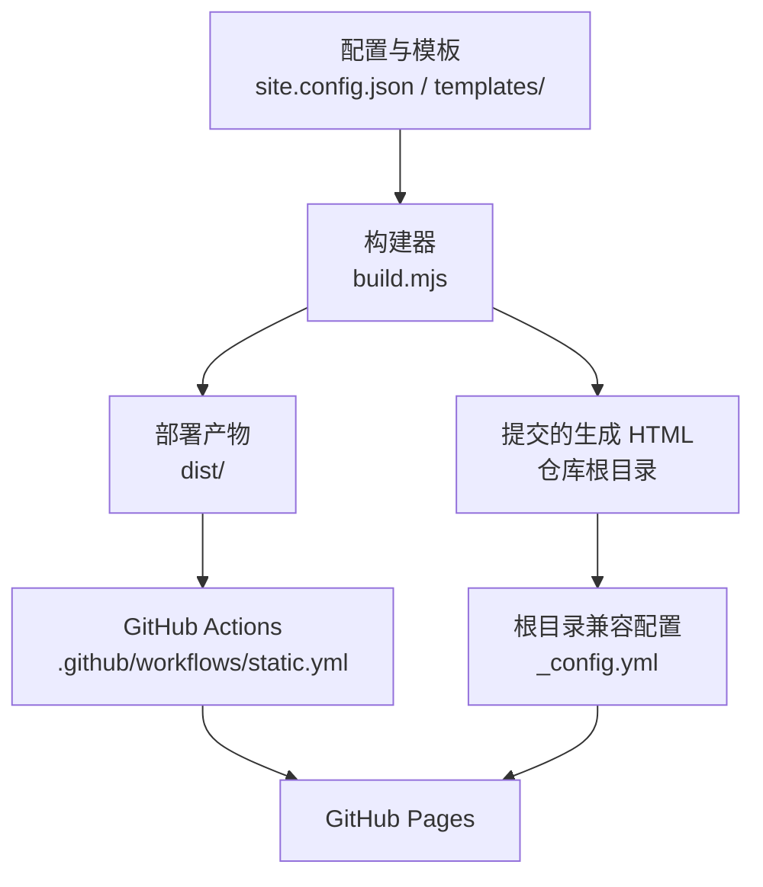
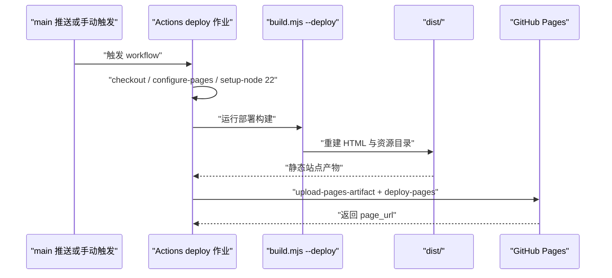
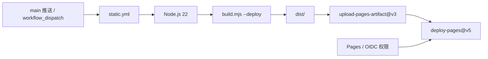

# 部署与维护

## 目录
1. [简介](#简介)
2. [项目结构](#项目结构)
3. [核心组件](#核心组件)
4. [架构总览](#架构总览)
5. [详细组件分析](#详细组件分析)
6. [依赖关系分析](#依赖关系分析)
7. [性能与一致性考量](#性能与一致性考量)
8. [故障排查指南](#故障排查指南)
9. [结论](#结论)

## 简介
仓库用 GitHub Actions 从模板源文件构建 `dist/`，再将该目录作为 GitHub Pages 产物部署。根目录同时保留生成 HTML 和 `_config.yml`，用于兼容现有的 Jekyll 根目录发布设置；两种产物来自同一个构建脚本，而日常维护依靠生成检查保持源文件与提交页面一致。

- `main` 分支推送和手动 `workflow_dispatch` 都可触发部署工作流。
- CI 使用 Node.js 22，仓库声明本地最低版本为 Node.js 20。
- `dist/` 和 `artifacts-screens/` 被 Git 忽略，文本统一使用 LF 换行。

章节来源
- [README.md:5-9](file://README.md#L5-L9)
- [package.json:4-9](file://package.json#L4-L9)
- [.github/workflows/static.yml:4-10](file://.github/workflows/static.yml#L4-L10)
- [.gitignore:1-2](file://.gitignore#L1-L2)
- [.gitattributes:1-3](file://.gitattributes#L1-L3)

## 项目结构
部署与维护职责集中在工作流、构建器和版本库配置三个层面。工作流选择运行环境并上传产物，构建器决定发布边界，版本库配置决定哪些产物需要提交和如何保存换行。

```
.github/workflows/static.yml  # GitHub Pages 工作流
build.mjs                     # 普通构建、漂移检查、dist 生成
package.json                  # build / check / deploy:build 命令
_config.yml                   # Jekyll 根目录发布排除清单
.gitignore                    # 忽略 dist 和本地截图产物
.gitattributes                # 文本 LF 与图片二进制规则
*.html                        # 根目录生成页面，随源码提交
dist/                         # Actions 上传的发布产物
```

结构图对比两条发布路径：Actions 以 `dist/` 为明确上传边界，而根目录兼容配置通过 `_config.yml` 排除模板和构建源码。



图表来源
- [README.md:3-7](file://README.md#L3-L7)
- [build.mjs:15-18](file://build.mjs#L15-L18)
- [.github/workflows/static.yml:40-48](file://.github/workflows/static.yml#L40-L48)
- [_config.yml:1-8](file://_config.yml#L1-L8)

章节来源
- [README.md:5-7](file://README.md#L5-L7)
- [.github/workflows/static.yml:24-48](file://.github/workflows/static.yml#L24-L48)
- [_config.yml:1-8](file://_config.yml#L1-L8)
- [.gitignore:1-2](file://.gitignore#L1-L2)

## 核心组件
下表将发布职责与仓库内控制文件对应起来；每一行都控制一个明确边界，便于根据发布问题选择排查入口。

| 组件 | 关键文件 | 一句话职责 |
| --- | --- | --- |
| Actions 工作流 | `.github/workflows/static.yml` | 检出仓库、设置 Pages 与 Node.js，构建并部署 `dist/`。 |
| 部署构建器 | `build.mjs` | 重建固定 `dist/`，写 HTML 并复制样式、脚本和素材。 |
| 开发命令 | `package.json` | 提供 `build`、`check`、`deploy:build` 三个一致的命令入口。 |
| 根目录兼容配置 | `_config.yml` | 为 Jekyll 根目录发布排除模板、脚本、配置和 `dist/`。 |
| Git 文件策略 | `.gitignore`、`.gitattributes` | 忽略本地部署/截图产物，规范文本与图片保存方式。 |

仓库没有额外的部署插件或自定义服务进程。发布配置可在工作流中调整触发分支、运行 Node.js 版本和上传目录，但上传目录必须与构建器输出边界保持一致。

章节来源
- [.github/workflows/static.yml:4-48](file://.github/workflows/static.yml#L4-L48)
- [build.mjs:57-93](file://build.mjs#L57-L93)
- [package.json:4-9](file://package.json#L4-L9)
- [_config.yml:1-8](file://_config.yml#L1-L8)
- [.gitignore:1-2](file://.gitignore#L1-L2)
- [.gitattributes:1-3](file://.gitattributes#L1-L3)

## 架构总览
工作流只有一个 `deploy` 作业，运行在 `ubuntu-latest`，环境名称为 `github-pages`。检出源码后依次配置 Pages、安装 Node.js 22、执行 `node build.mjs --deploy`、上传 `./dist`，最后调用 Pages 部署动作；环境 URL 使用部署步骤返回的 `page_url`。

时序图展示一个触发事件如何产生可发布的静态目录，帮助确认生成步骤发生在上传之前。



图表来源
- [.github/workflows/static.yml:4-10](file://.github/workflows/static.yml#L4-L10)
- [.github/workflows/static.yml:24-48](file://.github/workflows/static.yml#L24-L48)
- [build.mjs:57-93](file://build.mjs#L57-L93)

章节来源
- [.github/workflows/static.yml:24-48](file://.github/workflows/static.yml#L24-L48)
- [build.mjs:57-93](file://build.mjs#L57-L93)

## 详细组件分析
部署控制可分为 Actions 产物路径、根目录兼容路径以及日常维护路径。它们共享配置和模板输入，但对目录清理、提交与校验的职责各不相同。

### Actions 的 dist 发布
`deploy` 作业给 `GITHUB_TOKEN` 设置 `contents: read`、`pages: write` 和 `id-token: write`。同一 `pages` 并发组中的部署串行处理，并明确设置 `cancel-in-progress: false`，避免正在执行的生产部署被后续运行中断。

构建器在部署模式中只允许清空固定的 `dist/` 子目录，重新生成每个 HTML 后复制 `pages.css`、`site.js` 和 `assets/`。工作流上传的路径为 `./dist`，因此模板、构建脚本和配置 JSON 不作为浏览器站点资源被上传。

章节来源
- [.github/workflows/static.yml:12-22](file://.github/workflows/static.yml#L12-L22)
- [.github/workflows/static.yml:40-48](file://.github/workflows/static.yml#L40-L48)
- [build.mjs:57-62](file://build.mjs#L57-L62)
- [build.mjs:90-93](file://build.mjs#L90-L93)

### 根目录 Jekyll 兼容
根目录保留普通 `npm run build` 生成的 HTML，供仍然使用根目录发布设置的 Pages 配置消费。`_config.yml` 将 `templates`、`build.mjs`、`site.config.json`、`package.json`、`README.md` 和 `dist` 排除，避免将维护源文件当作网页输出。

这是一份兼容配置，不代表 Actions 作业会执行 Jekyll；当前工作流使用明确的 `dist` 上传路径。维护时应理解两条路径各自的边界，避免只更新 `dist/` 而忘记需要提交的根目录 HTML。

章节来源
- [README.md:5-7](file://README.md#L5-L7)
- [_config.yml:1-8](file://_config.yml#L1-L8)
- [.github/workflows/static.yml:40-48](file://.github/workflows/static.yml#L40-L48)

### 维护顺序与校验范围
新增页面时应在 `site.config.json` 添加合法且唯一的 `.html` 文件名、导航标签、图标字段、标题与摘要，并准备同名 `templates/pages/<file>` 正文。修改共享布局、配置或素材后，再执行 `npm run build` 更新根目录生成 HTML，提交前运行 `npm run check`，需要预览发布产物时再执行 `npm run deploy:build`。

`npm run check` 只验证当前渲染结果与根目录 HTML 是否一致，不检查链接可用性、浏览器样式或 GitHub Pages 发布成功。年份和任职时长按上海时区在构建时生成后备文本，换月后检查可能提示重建；教育年份与真实入职月份继续作为历史事实保留。

章节来源
- [README.md:5-9](file://README.md#L5-L9)
- [package.json:4-9](file://package.json#L4-L9)
- [build.mjs:19-34](file://build.mjs#L19-L34)
- [build.mjs:64-85](file://build.mjs#L64-L85)

### Git 文件保存策略
`.gitignore` 忽略 `dist/` 和 `artifacts-screens/`，让发布目录与本地截图成果无需进入版本库。`.gitattributes` 对文本启用自动识别并固定 `eol=lf`，同时将 WebP 和 JPEG 声明为二进制文件。

生成检查会将已有文件的 CRLF 替换为 LF 再比较，减少 Windows 与 Linux 环境的换行差异。该规则针对文本一致性，图片是否更新仍需要维护者检查文件本身和引用路径。

章节来源
- [.gitignore:1-2](file://.gitignore#L1-L2)
- [.gitattributes:1-3](file://.gitattributes#L1-L3)
- [build.mjs:82-85](file://build.mjs#L82-L85)

## 依赖关系分析
本地生成需要 Node.js 20 或以上，CI 选择 Node.js 22；构建器通过 Node.js 内置模块完成文件读写和路径处理。发布阶段依赖仓库内固定版本的 GitHub Actions 动作，以及 GitHub Pages 环境和令牌权限。



图表来源
- [.github/workflows/static.yml:4-16](file://.github/workflows/static.yml#L4-L16)
- [.github/workflows/static.yml:32-48](file://.github/workflows/static.yml#L32-L48)
- [package.json:9-9](file://package.json#L9-L9)

章节来源
- [package.json:4-9](file://package.json#L4-L9)
- [build.mjs:6-8](file://build.mjs#L6-L8)
- [.github/workflows/static.yml:12-48](file://.github/workflows/static.yml#L12-L48)

## 性能与一致性考量
部署构建每次从固定目录重建，避免残留页面或过期资源混入发布产物。工作流不设置依赖安装步骤，因为构建器没有第三方包；并发组控制部署顺序，生成检查则关注提交页面与源文件的一致性。

- `dist/` 清空前验证目录边界，降低误清理源码目录的风险。
- 不取消正在进行的部署，保证一个运行完成后再处理后续发布。
- `--check` 忽略 CRLF 与 LF 差异，但换月后年份/任职后备文本变化仍会被检测。
- 根目录生成 HTML 应随模板或配置修改同步提交，`dist/` 作为临时发布产物保留在忽略清单中。

章节来源
- [README.md:5-9](file://README.md#L5-L9)
- [.github/workflows/static.yml:18-22](file://.github/workflows/static.yml#L18-L22)
- [build.mjs:57-62](file://build.mjs#L57-L62)
- [build.mjs:82-85](file://build.mjs#L82-L85)
- [.gitignore:1-2](file://.gitignore#L1-L2)

## 故障排查指南
遇到发布问题时先确认失败发生在构建、上传还是部署步骤，再核对产物路径与版本库生成文件；不要把 `npm run check` 的成功视为远程 Pages 已成功发布。

- **检查提示 `needs rebuilding`** → 原因是模板、配置或年月后备文本与根目录 HTML 不一致 → 运行 `npm run build`，审阅生成文件并再次 `npm run check` → 相关位置为 `build.mjs` 的比较分支和 README 维护要求。
- **Actions 没有运行** → 原因可能是推送分支不是 `main` 或没有手动触发 → 检查工作流 `on.push.branches` 与 `workflow_dispatch` → 相关位置为 `static.yml` 触发配置。
- **上传的站点缺少页面或图片** → 原因是上传目录与部署构建目录不一致或构建未成功 → 检查 `node build.mjs --deploy` 的输出和 `path: './dist'`，确认资源复制清单包含 CSS、JS 与 `assets` → 相关位置为工作流构建/上传步骤和构建器复制循环。
- **Pages 部署步骤失败** → 原因可能与环境、令牌权限或 Pages 配置有关 → 检查 `github-pages` 环境、`pages: write` 和 `id-token: write`，再读 `deploy-pages` 步骤日志 → 相关位置为工作流权限和部署步骤。
- **根目录发布暴露源文件** → 原因是 `_config.yml` 排除清单缺失或发布源设置变化 → 核对模板、构建脚本、配置 JSON 与 `dist` 是否仍列入 `exclude` → 相关位置为 Jekyll 兼容配置。

章节来源
- [README.md:5-7](file://README.md#L5-L7)
- [build.mjs:79-93](file://build.mjs#L79-L93)
- [.github/workflows/static.yml:4-16](file://.github/workflows/static.yml#L4-L16)
- [.github/workflows/static.yml:24-48](file://.github/workflows/static.yml#L24-L48)
- [_config.yml:1-8](file://_config.yml#L1-L8)

## 结论
发布维护的核心是同一套模板源文件驱动两种静态产物：根目录 HTML 用于提交和兼容发布，`dist/` 用于 Actions 上传。修改后先构建、审阅、检查生成一致性，再检查部署工作流与实际浏览器页面，能够把源文件、产物和远程发布状态分别验证清楚。

章节来源
- [README.md:5-9](file://README.md#L5-L9)
- [package.json:4-9](file://package.json#L4-L9)
- [.github/workflows/static.yml:40-48](file://.github/workflows/static.yml#L40-L48)

<cite>
**本文引用的文件**
- [README.md](file://README.md)
- [package.json](file://package.json)
- [build.mjs](file://build.mjs)
- [.github/workflows/static.yml](file://.github/workflows/static.yml)
- [_config.yml](file://_config.yml)
- [.gitignore](file://.gitignore)
- [.gitattributes](file://.gitattributes)
</cite>
