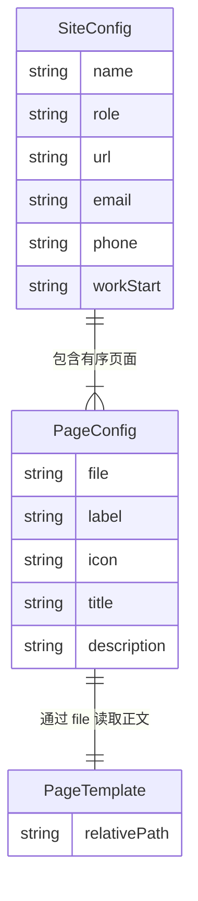
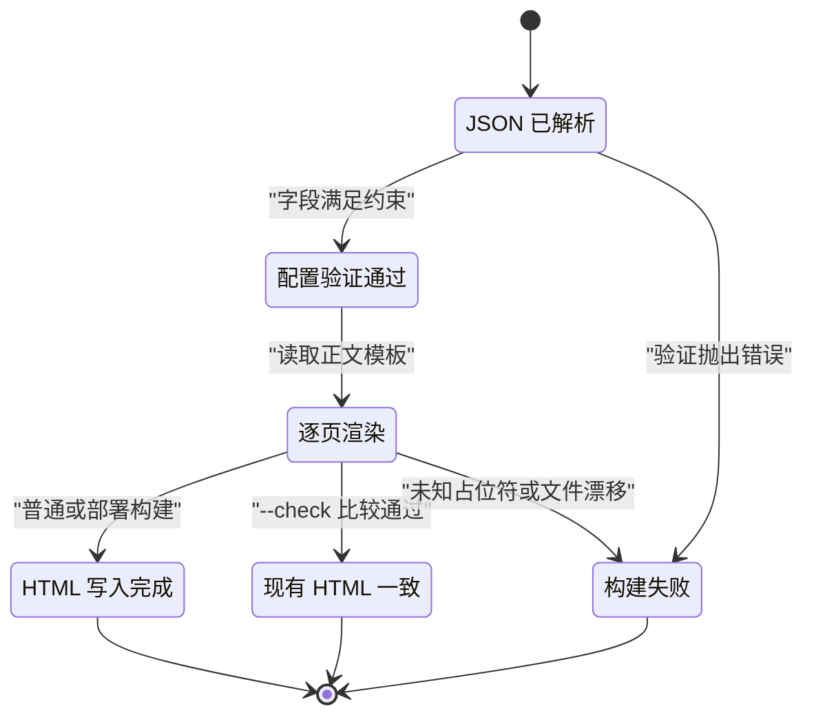
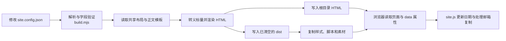

# 站点配置模型

## 目录
1. [简介](#简介)
2. [数据模型总览](#数据模型总览)
3. [核心实体分析](#核心实体分析)
4. [状态机](#状态机)
5. [存储与序列化](#存储与序列化)
6. [数据生命周期](#数据生命周期)
7. [故障排查指南](#故障排查指南)
8. [结论](#结论)

## 简介
站点的品牌信息、联系方式和页面清单集中保存在 `site.config.json`，由 `build.mjs` 读取并写入生成的 HTML。配置同时影响导航、浏览器标题、搜索描述、分享信息和页脚，因此一次修改会作用于多张页面。本页使用 `SiteConfig` 和 `PageConfig` 作为数据结构的说明名称；仓库没有声明同名类或类型，也没有数据库模型。

章节来源
- [site.config.json:1-18](file://site.config.json#L1-L18)
- [build.mjs:17-29](file://build.mjs#L17-L29)
- [build.mjs:64-88](file://build.mjs#L64-L88)

## 数据模型总览
一个 `SiteConfig` 对象包含站点级标量和一个有序的 `pages` 数组，数组中的每个 `PageConfig` 对应一个正文模板和一个输出文件。配置的数组顺序直接决定导航链接顺序以及构建遍历顺序，而模板通过 `file` 字段与页面记录匹配。下面的实体关系图展示这些逻辑关系，`PageTemplate` 是文件关系的概念实体，不是额外的 JSON 字段。

该模型把共享信息和逐页信息分开管理；正文模板的存在性在读取阶段确认，而非写成配置内的引用完整性规则。

图表来源
- [site.config.json:1-18](file://site.config.json#L1-L18)
- [build.mjs:64-79](file://build.mjs#L64-L79)

章节来源
- [site.config.json:1-18](file://site.config.json#L1-L18)
- [build.mjs:21-29](file://build.mjs#L21-L29)
- [build.mjs:64-79](file://build.mjs#L64-L79)

## 核心实体分析
配置采用可直接编辑的 JSON，没有运行时表单或独立的 schema 文件。构建脚本对 URL、工作起始月和页面清单执行显式验证，其余字段依靠模板消费和 HTML 转义。维护时应区分“当前 JSON 的字段类型”和“构建程序真正强制的约束”，避免把编辑约定误认为完整的输入校验。

章节来源
- [site.config.json:1-18](file://site.config.json#L1-L18)
- [build.mjs:17-29](file://build.mjs#L17-L29)
- [build.mjs:36-42](file://build.mjs#L36-L42)

### SiteConfig
`SiteConfig` 的当前标量均为字符串，提供所有页面共享的信息。`name` 和 `role` 形成品牌与职业定位，`email` 和 `phone` 进入可见文本与联系链接，`url` 提供绝对地址基准。联系方式会被发布到生成页面，不能把此文件当作私密配置存储；此处只说明字段用途，不重复具体号码或地址。

- `name`：写入品牌、站点名、页面标题和页脚。
- `role`：写入页脚职业说明。
- `url`：必须满足构建脚本的 HTTP/HTTPS 绝对地址模式，并以 `/` 结尾；首页使用 `./`，其余页面使用文件名，经 `new URL()` 生成 canonical 和分享地址。
- `email`：写入邮箱复制按钮的 `data-copy-email`、`mailto:` 链接和联系页文本。
- `phone`：写入 `tel:` 链接和联系页、页脚文本。
- `workStart`：必须符合 `YYYY-MM`，月份限制为 `01` 至 `12`；构建时按上海时区当前年月计算任职月数，负值钳制为零。
- `pages`：必须是非空数组，且至少包含 `index.html`。

脚本没有单独验证 `name`、`role`、`email`、`phone` 的非空性或格式，`escapeHtml()` 会把输入转为字符串。维护者因此仍需保证这些字段为合适的公开文本。日期约束只检查格式，没有限制起始年份的业务范围。

章节来源
- [site.config.json:2-8](file://site.config.json#L2-L8)
- [build.mjs:19-34](file://build.mjs#L19-L34)
- [build.mjs:40-42](file://build.mjs#L40-L42)
- [build.mjs:64-74](file://build.mjs#L64-L74)
- [templates/layout.html:33-51](file://templates/layout.html#L33-L51)
- [templates/pages/contact.html:10-19](file://templates/pages/contact.html#L10-L19)

### PageConfig
`PageConfig` 把输出文件名、导航标签和页面元数据绑定在一条记录中。`file` 同时用于读取 `templates/pages/<file>`、确定输出位置和生成链接，因此新页面需要配置与正文模板同时就绪。`pages` 当前包含八条记录，构建过程不会另行排序。

- `file`：必须是字符串、无目录分隔符且以 `.html` 结尾；文件名通过 `Set` 检查精确重复，至少一条记录必须恰好为 `index.html`。
- `label`：非空字符串，作为顶部导航可见文本。
- `icon`：非空字符串，保留在配置中；当前导航生成逻辑只使用文字标签，并未渲染图标。
- `title`：非空字符串，与站点名称拼接后写入 `<title>` 和分享标题。
- `description`：非空字符串，用于普通描述、Open Graph 描述和 Twitter 描述。

非空校验使用字符串真值判断，没有去除首尾空白，也没有对这些字段施加长度限制。正文模板必须存在，但这是后续 `readFile()` 的要求；配置验证没有预先扫描模板目录。当前页面的链接增加 `class="current"` 和 `aria-current="page"`，其余导航链接不带这两个属性。

章节来源
- [site.config.json:8-17](file://site.config.json#L8-L17)
- [build.mjs:21-29](file://build.mjs#L21-L29)
- [build.mjs:64-78](file://build.mjs#L64-L78)
- [templates/layout.html:7-25](file://templates/layout.html#L7-L25)

## 状态机
配置没有 `status` 字段，也没有草稿、发布或归档的业务状态机。它的隐式状态来自构建过程：JSON 成功解析后先验证约束，再逐页渲染，最后选择写文件或与现有 HTML 比较。以下状态图是对程序控制流的概念表达，状态名称并非仓库中的持久化字段。

配置修改本身不会自动刷新根目录 HTML；只有成功运行构建后，新值才进入静态页面，检查模式则只判断是否存在漂移。

图表来源
- [build.mjs:17-29](file://build.mjs#L17-L29)
- [build.mjs:50-55](file://build.mjs#L50-L55)
- [build.mjs:64-88](file://build.mjs#L64-L88)

章节来源
- [build.mjs:11-29](file://build.mjs#L11-L29)
- [build.mjs:50-55](file://build.mjs#L50-L55)
- [build.mjs:79-88](file://build.mjs#L79-L88)

## 存储与序列化
持久源数据是仓库根目录的 `site.config.json`，构建时经 UTF-8 读取和 `JSON.parse()` 形成内存对象。程序不把这个对象写回 JSON，也不把整个配置直接交给浏览器；浏览器消费的是已生成的 HTML 文本、属性和 `data-*` 值。此过程采用有限的占位符替换，不执行配置或模板中的脚本表达式。

- 输入存储：JSON 文件提供共享标量与页面数组，正文和布局分别保存在 HTML 模板文件中。
- 输出序列化：标量经 `escapeHtml()` 处理 `&`、`<`、`>`、双引号和单引号，再写入 UTF-8 HTML。
- 模板边界：`render()` 仅替换形如 `{{NAME}}` 的大写命名占位符；缺少键会抛错。正文模板本身作为可信 HTML 插入布局，标量转义不等于模板内容净化。
- 浏览器消费：邮箱从 `data-copy-email` 读取，年份更新使用 `textContent`，任职时长从 `data-experience-start` 读取。

转义解决文本与属性中的特殊字符问题，没有为邮箱或电话号码做语义格式验证。联系方式仍是公开内容；维护者应只填写愿意展示的值，并保持模板来源可信。

章节来源
- [build.mjs:17-18](file://build.mjs#L17-L18)
- [build.mjs:36-55](file://build.mjs#L36-L55)
- [build.mjs:64-88](file://build.mjs#L64-L88)
- [templates/layout.html:38-51](file://templates/layout.html#L38-L51)
- [site.js:6-18](file://site.js#L6-L18)
- [site.js:27-40](file://site.js#L27-L40)

## 数据生命周期
配置由维护者修改，随后在每次构建中重新读取、验证和映射到各页模板。普通构建将 HTML 写入根目录，`--deploy` 将页面写入固定的 `dist` 目录并复制样式、脚本和素材；浏览器访问时继续更新年份和任职时长。仓库没有配置归档或历史状态管理，删除页面记录也不会在普通构建中清理此前生成的根目录文件。

下面的依赖图展示配置从编辑到浏览器使用的路径，也标出部署目录清理的位置。

生命周期中的清理仅针对部署产物目录；配置文件和源模板不由该流程清理。

图表来源
- [build.mjs:15-29](file://build.mjs#L15-L29)
- [build.mjs:57-94](file://build.mjs#L57-L94)
- [site.js:5-43](file://site.js#L5-L43)

章节来源
- [build.mjs:15-29](file://build.mjs#L15-L29)
- [build.mjs:57-94](file://build.mjs#L57-L94)
- [site.js:5-43](file://site.js#L5-L43)

## 故障排查指南
配置问题通常在构建阶段暴露，浏览器显示异常则需要同时检查模板属性和生成结果。排查时先依据异常文本定位验证或渲染阶段，再确认配置字段与对应模板是否同步。任职时长尤其需要区分构建的后备文本和浏览器重新计算的文本，两者当前并不共享同一个模板起始月来源。

- URL 错误：检查 `url` 是否为以 `/` 结尾的 HTTP/HTTPS 绝对地址；canonical 与分享链接均依赖该基准。
- 工作年月错误：检查 `workStart` 的年月格式。`resume.html` 的 `data-experience-start` 当前直接写为固定年月，未使用构建提供的 `WORK_START` 占位符；修改配置时应注意这一同步边界。
- 页面清单错误：依次检查非空数组、唯一文件名、`.html` 后缀和 `index.html` 记录；再确认对应正文模板真实存在。
- 文字字段缺失：页面记录的 `label`、`icon`、`title`、`description` 会触发显式错误，共享标量则缺少对应的非空校验，应直接检查 JSON 内容。
- `Unknown template value`：检查模板占位符名称是否属于构建提供的键，而非把任意 JSON 字段写进模板。
- `needs rebuilding`：`--check` 比较发现生成结果与根目录 HTML 不一致；配置变更或上海时区跨月都可能要求重新构建。

章节来源
- [build.mjs:19-34](file://build.mjs#L19-L34)
- [build.mjs:50-55](file://build.mjs#L50-L55)
- [build.mjs:64-85](file://build.mjs#L64-L85)
- [templates/pages/resume.html:8-12](file://templates/pages/resume.html#L8-L12)
- [site.js:6-15](file://site.js#L6-L15)

## 结论
站点配置是静态生成过程的共享数据入口，正确维护它可以同步品牌、导航和页面元数据。使用时应遵守 URL、年月和页面清单约束，并在修改后重新构建确认输出。共享联系信息会直接公开，模板起始月等独立写入的数据还需要维护者同步核对。

章节来源
- [site.config.json:1-18](file://site.config.json#L1-L18)
- [build.mjs:19-29](file://build.mjs#L19-L29)
- [build.mjs:64-88](file://build.mjs#L64-L88)
- [templates/pages/resume.html:8-12](file://templates/pages/resume.html#L8-L12)

<cite>
**本文引用的文件**
- [site.config.json](file://site.config.json)
- [build.mjs](file://build.mjs)
- [layout.html](file://templates/layout.html)
- [site.js](file://site.js)
- [contact.html](file://templates/pages/contact.html)
- [resume.html](file://templates/pages/resume.html)
</cite>
