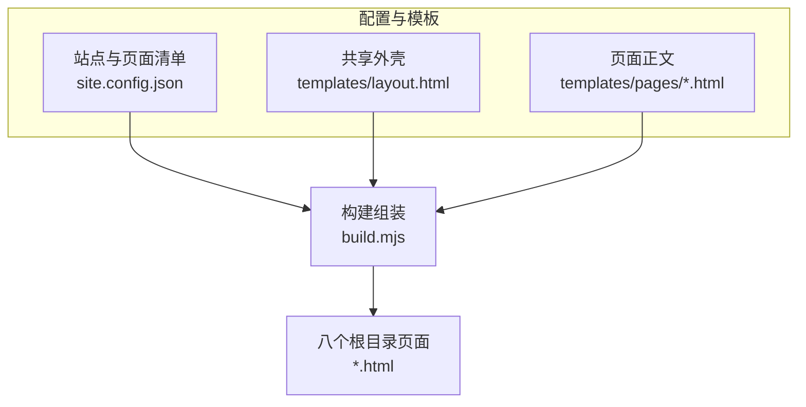
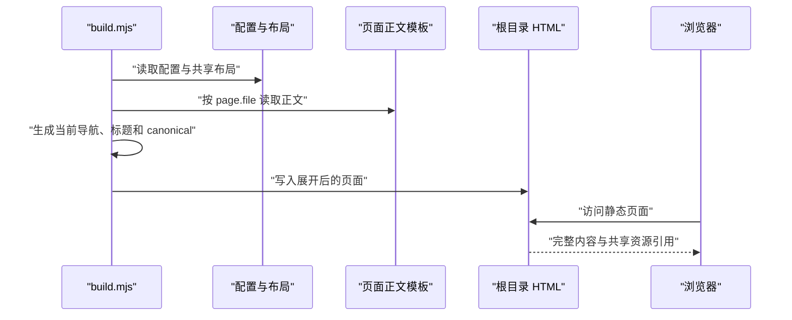
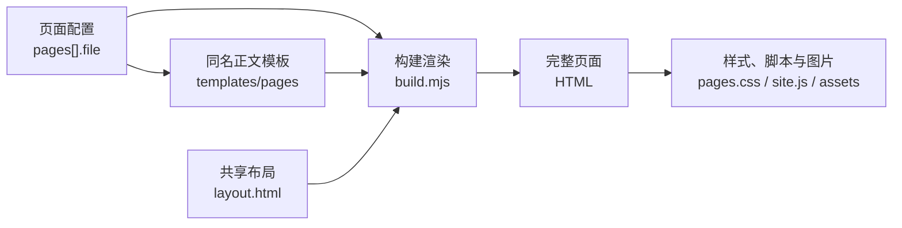

# 配置与页面

## 目录
1. [简介](#简介)
2. [项目结构](#项目结构)
3. [核心组件](#核心组件)
4. [架构总览](#架构总览)
5. [详细组件分析](#详细组件分析)
6. [依赖关系分析](#依赖关系分析)
7. [性能与一致性考量](#性能与一致性考量)
8. [故障排查指南](#故障排查指南)
9. [结论](#结论)

## 简介
本仓库以八个静态 HTML 页面呈现个人作品集，页面清单、身份信息和搜索摘要集中保存在 `site.config.json`。共享布局把页面正文包在统一的头部导航、主内容区与页脚中，构建程序负责展开配置和模板。根目录 HTML 是生成产物，案例页中的 Coze、模型 API、RPA 等内容属于作品说明，不能据此把站点理解为在线执行这些流程的应用。

- 页面语言为简体中文，布局声明 `lang="zh-CN"`。
- 站点包含首页、案例目录、三个案例详情、经历、关于与联系共八个页面。
- 所有页面共享 `pages.css` 与延迟执行的 `site.js`，主要内容在 HTML 中直接可读。

章节来源
- [site.config.json:1-18](file://site.config.json#L1-L18)
- [templates/layout.html:1-56](file://templates/layout.html#L1-L56)
- [case-content.html:53-86](file://case-content.html#L53-L86)

## 项目结构
配置和模板是页面生成的输入，根目录的同名 HTML 是浏览器与发布环境消费的输出。正文模板按配置中的 `file` 字段寻找，因此页面文件名也是配置与内容之间的连接键。阅读根目录 HTML 可以观察最终导航与元信息，维护内容时应回到模板和配置。

```
site.config.json
build.mjs
templates/
  layout.html
  pages/
    index.html
    portfolio.html
    case-content.html
    case-visual.html
    case-data.html
    resume.html
    about.html
    contact.html
index.html
portfolio.html
case-content.html
case-visual.html
case-data.html
resume.html
about.html
contact.html
```

- `site.config.json` 定义八个页面的文件名、导航文本、图标预留字段、标题与描述。
- `templates/layout.html` 定义共享外壳，通过命名占位符接收页面内容和配置值。
- `templates/pages/` 为每个配置项提供同名正文模板，构建时读取并插入 `CONTENT`。
- 根目录页面已经包含完整外壳，文件开头标明由 `build.mjs` 生成。

下面的结构图强调“共享输入产生多个独立页面”的关系，避免把生成文件当作唯一内容来源。



图中三个输入共同决定页面结果；仅修改已生成 HTML 会与下一次构建产生不一致。

图表来源
- [build.mjs:17-18](file://build.mjs#L17-L18)
- [build.mjs:64-88](file://build.mjs#L64-L88)

章节来源
- [site.config.json:8-17](file://site.config.json#L8-L17)
- [templates/layout.html:30-53](file://templates/layout.html#L30-L53)
- [index.html:1-2](file://index.html#L1-L2)
- [build.mjs:64-88](file://build.mjs#L64-L88)

## 核心组件
页面体系由一个清单、一份共享布局、多份正文和一个组装程序构成。页面自己的标题与摘要来自清单，共享身份与联系方式来自顶层配置，正文则由对应模板提供。导航和内容不是运行时从远程服务请求的，而是在构建阶段进入 HTML。

- 站点配置：`name`、`role`、`url`、`email`、`phone`、`workStart` 提供共享身份、地址与日期参数。
- 页面清单：`pages` 决定导航顺序，并把 `file`、`label`、`title`、`description` 关联起来。
- 共享布局：`DESCRIPTION`、`TITLE`、`URL`、`IMAGE` 注入搜索与社交元信息，`NAV` 和 `CONTENT` 注入可见内容。
- 页面正文：首页承担入口，案例目录组织三项实践，经历、关于、联系补充个人背景与沟通渠道。
- 构建组装：`build.mjs` 转义配置标量、确定当前页面导航状态，并写入对应 HTML。
- 扩展位置：新增页面需要增加 `pages` 配置和同名正文模板；`icon` 当前经过配置校验但不参与导航输出。

章节来源
- [site.config.json:1-18](file://site.config.json#L1-L18)
- [templates/layout.html:7-51](file://templates/layout.html#L7-L51)
- [build.mjs:23-29](file://build.mjs#L23-L29)
- [build.mjs:64-78](file://build.mjs#L64-L78)
- [portfolio.html:62-94](file://portfolio.html#L62-L94)

## 架构总览
页面组装从读取配置和布局开始，随后遍历 `pages`，读取每页正文并生成导航和元信息。导航激活态通过 `item.file === page.file` 决定，当前链接同时获得 `class="current"` 和 `aria-current="page"`。访问阶段浏览器直接接收完整页面，再加载共享 CSS 和 JavaScript，案例介绍本身没有模型调用步骤。

下面的时序图把构建阶段与浏览器访问阶段放在一起，展示数据何时被固定到页面中。



页面结构在构建时已完成，因此当前页状态不依赖浏览器脚本动态识别 URL。

图表来源
- [build.mjs:17-18](file://build.mjs#L17-L18)
- [build.mjs:64-88](file://build.mjs#L64-L88)
- [index.html:24-42](file://index.html#L24-L42)

章节来源
- [build.mjs:64-88](file://build.mjs#L64-L88)
- [templates/layout.html:24-46](file://templates/layout.html#L24-L46)
- [case-content.html:53-86](file://case-content.html#L53-L86)

## 详细组件分析
八个页面共享外壳，但承担不同的阅读路径。首页引导访问者进入作品、经历或方法说明，案例目录再连接三个独立详情页；联系页保留直接电话与邮件链接。下面按配置、外壳与内容组织展开，重点说明可修改位置和现有输出的边界。

章节来源
- [index.html:114-137](file://index.html#L114-L137)
- [portfolio.html:62-94](file://portfolio.html#L62-L94)
- [contact.html:62-71](file://contact.html#L62-L71)

### 页面清单与文件对应
`pages` 中八个 `file` 值与根目录文件一一对应，顺序也就是导航顺序。构建要求文件为不含目录分隔符的 `.html` 名称，并要求存在 `index.html`，所以页面清单不是任意 URL 的集合。`icon` 字段仍是必填配置，但现有导航输出只使用 `label`。

- `index.html` 对应“首页”，展示个人定位、能力概览与三个入口。
- `portfolio.html` 对应“案例”，聚合内容、视觉、数据三个作品详情。
- `case-content.html` 对应“Workflow”，说明标题与种草文案自动化。
- `case-visual.html` 对应“视觉”，说明商品图生成、参考图和视觉约束。
- `case-data.html` 对应“数据”，说明商品图分析、预测设想和重复流程。
- `resume.html` 对应“经历”，呈现任职、教育、业绩与能力。
- `about.html` 对应“关于”，呈现工作方式与机会方向。
- `contact.html` 对应“联系”，提供电话与邮箱入口。

章节来源
- [site.config.json:8-17](file://site.config.json#L8-L17)
- [build.mjs:23-29](file://build.mjs#L23-L29)
- [build.mjs:67-68](file://build.mjs#L67-L68)
- [index.html:53-137](file://index.html#L53-L137)
- [resume.html:53-106](file://resume.html#L53-L106)
- [about.html:53-75](file://about.html#L53-L75)
- [contact.html:53-71](file://contact.html#L53-L71)

### 共享布局、导航和元信息
布局中的 `header`、`main`、`footer` 保证每个页面保留同一套导航、联系入口和版权信息。`TITLE` 同时进入页面标题、Open Graph 与 Twitter 字段，`DESCRIPTION` 进入三处摘要，`URL` 同时作为社交 URL 与 canonical。首页 URL 使用配置基址，其他页面以文件名解析，首页外层还额外获得 `home-page` 类。

- `NAV` 插入八个文本链接，激活态在构建阶段生成。
- `CONTENT` 插入正文；共享联系方式通过 `EMAIL`、`PHONE` 进入头部和页脚。
- 社交预览图片统一解析为 `assets/social-preview.jpg` 的绝对 URL。
- 复制邮箱按钮起始为隐藏状态，并有 `noscript` 邮件链接作为无脚本入口。

章节来源
- [templates/layout.html:7-53](file://templates/layout.html#L7-L53)
- [build.mjs:65-78](file://build.mjs#L65-L78)
- [index.html:7-50](file://index.html#L7-L50)

### 作品说明与运行代码边界
三个案例页以段落、标签和截图描述已实践或正在探索的业务流程。内容页写出 Coze 调用模型的方案，视觉页写出图像 API 与约束方式，数据页明确使用“未来可结合”描述预测扩展；这些都是静态展示文本。读者可以理解作品的方法与证据，但页面没有提供商品输入表单、执行按钮或模型返回结果界面。

- 内容案例展示 Workflow 截图及标题优化、文案生成和批量处理的说明。
- 视觉案例展示工作内容、产品判断和视觉生成 Workflow 截图。
- 数据案例展示商品图数据矩阵，并区分现有分析说明与未来预测设想。
- 案例目录是进入详情的导航入口，详情页的返回链接回到 `portfolio.html`。

章节来源
- [portfolio.html:62-94](file://portfolio.html#L62-L94)
- [case-content.html:53-86](file://case-content.html#L53-L86)
- [case-visual.html:53-85](file://case-visual.html#L53-L85)
- [case-data.html:53-81](file://case-data.html#L53-L81)

## 依赖关系分析
配置和模板之间的主要依赖是文件名以及固定的占位符集合。页面在浏览器里依赖共享样式、脚本与本地图片，配置中的部署 URL 则用于生成绝对元信息地址。这里没有按案例名称引入 Coze、影刀或模型 SDK；相关产品名称只是内容文本。

- 必选：配置中的每个 `file` 都要有对应 `templates/pages/<file>`，否则构建无法读取正文。
- 必选：布局占位符必须存在于渲染值集合中，未知占位符会抛出 `Unknown template value`。
- 必选：生成页面引用 `pages.css`、`site.js`、favicon，案例图引用 `assets/` 中的 WebP 文件。
- 推荐：`url` 指向实际发布基址，使 canonical、社交链接与预览图片保持一致。
- 可选：用户浏览器或操作系统可以处理 `tel:`、`mailto:` 联系链接，页面本身不发送通信请求。

下面的依赖图展示内容生成所需输入与浏览器资源依赖，帮助定位遗漏文件。



图中内容和资源是两类不同依赖：正文缺失会阻断构建，资源缺失则可能在访问时表现为样式或图片异常。

图表来源
- [build.mjs:50-54](file://build.mjs#L50-L54)
- [build.mjs:64-78](file://build.mjs#L64-L78)
- [templates/layout.html:24-27](file://templates/layout.html#L24-L27)
- [case-visual.html:81-83](file://case-visual.html#L81-L83)

章节来源
- [build.mjs:19-29](file://build.mjs#L19-L29)
- [build.mjs:50-54](file://build.mjs#L50-L54)
- [build.mjs:64-78](file://build.mjs#L64-L78)
- [templates/layout.html:24-27](file://templates/layout.html#L24-L27)
- [contact.html:63-69](file://contact.html#L63-L69)

## 性能与一致性考量
静态页面在初始 HTML 中包含主要文本与导航，不需要等应用数据接口才能阅读。共享外壳减少多页人工维护的重复，但配置或布局变化后必须重新生成所有页面，才能让输出一致。案例图片用明确尺寸、异步解码和懒加载控制页面布局与加载时机，JavaScript 通过 `defer` 引用。

- 图片声明 `width`、`height`，让浏览器在图片加载前能预留比例空间。
- 案例图片使用 `loading="lazy"` 与 `decoding="async"`，其收益取决于浏览器与访问位置。
- `--check` 比较模板展开结果与根目录 HTML，并忽略平台换行差异。
- 年份与任职时长由构建程序按 `Asia/Shanghai` 生成年月后备文本，月度变化可能要求重新构建。
- 配置标量会经过 HTML 转义；正文模板作为可信 HTML 组装，并不通过该过程做安全净化。

章节来源
- [templates/layout.html:26-27](file://templates/layout.html#L26-L27)
- [case-content.html:68-70](file://case-content.html#L68-L70)
- [case-visual.html:81-83](file://case-visual.html#L81-L83)
- [case-data.html:77-79](file://case-data.html#L77-L79)
- [build.mjs:30-41](file://build.mjs#L30-L41)
- [build.mjs:77-85](file://build.mjs#L77-L85)

## 故障排查指南
排查页面问题时先区分配置、正文模板、共享外壳与已生成输出，再沿构建读取关系检查。导航、标题和联系方式异常通常来自配置或尚未重建，案例内容异常则优先检查同名正文模板。以下场景依据现有实现给出定位路径，不推断未出现的后端功能。

- 导航文本或顺序不符合预期 → `pages` 是唯一导航来源 → 检查配置的 `label` 和顺序，再检查生成页面的导航区 → 定位 `site.config.json` 第 8–17 行与 `build.mjs` 第 68 行。
- 新页面构建失败或导航出现页面却无内容 → 缺少同名正文模板，或 `file` 格式不符合约束 → 核对配置文件名与 `templates/pages/` 下同名文件，再查看读取错误 → 定位 `build.mjs` 第 23–29、66 行。
- 页签标题或分享摘要旧 → 修改生成 HTML、配置变化后未重建，或使用了错误字段 → 核对 `title`、`description` 及布局占位符，执行构建一致性检查 → 定位 `templates/layout.html` 第 7–25 行与 `build.mjs` 第 71–74、82–85 行。
- 当前导航激活项错误 → 对应配置文件名与构建当前页不一致，或输出过旧 → 核对生成 HTML 中唯一的 `aria-current="page"` 链接和配置 `file` → 定位 `build.mjs` 第 68 行与 `portfolio.html` 第 35–42 行。
- 点击案例页无法执行 AI 流程 → 页面提供的是作品介绍与截图 → 查看案例正文中是否只有静态说明，按作品展示用途理解此页面 → 定位 `case-content.html` 第 53–86 行与 `case-data.html` 第 64–79 行。

章节来源
- [site.config.json:8-17](file://site.config.json#L8-L17)
- [build.mjs:23-29](file://build.mjs#L23-L29)
- [build.mjs:64-85](file://build.mjs#L64-L85)
- [templates/layout.html:7-25](file://templates/layout.html#L7-L25)
- [portfolio.html:35-42](file://portfolio.html#L35-L42)
- [case-content.html:53-86](file://case-content.html#L53-L86)
- [case-data.html:64-79](file://case-data.html#L64-L79)

## 结论
配置与页面模块把八个作品集页面组织为共享外壳下的静态展示内容。维护时应以 `site.config.json` 和同名正文模板为输入，重新构建并检查输出，保证导航、元信息与联系方式统一。阅读案例时应把业务 Workflow 描述与站点自身的运行行为分开，页面的直接职责是说明作品并提供浏览与联系入口。

章节来源
- [site.config.json:1-18](file://site.config.json#L1-L18)
- [build.mjs:64-88](file://build.mjs#L64-L88)
- [case-content.html:53-86](file://case-content.html#L53-L86)
- [contact.html:62-71](file://contact.html#L62-L71)

<cite>
**本文引用的文件**
- [site.config.json](file://site.config.json)
- [layout.html](file://templates/layout.html)
- [build.mjs](file://build.mjs)
- [index.html](file://index.html)
- [portfolio.html](file://portfolio.html)
- [case-content.html](file://case-content.html)
- [case-visual.html](file://case-visual.html)
- [case-data.html](file://case-data.html)
- [resume.html](file://resume.html)
- [about.html](file://about.html)
- [contact.html](file://contact.html)
</cite>
