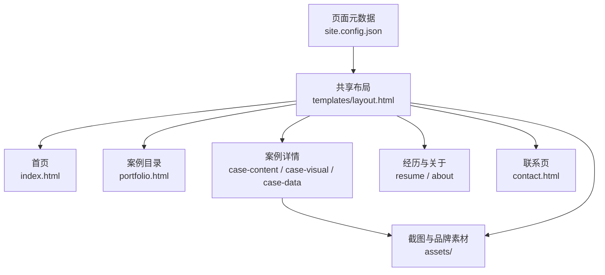
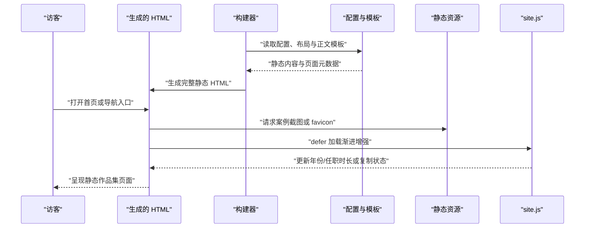
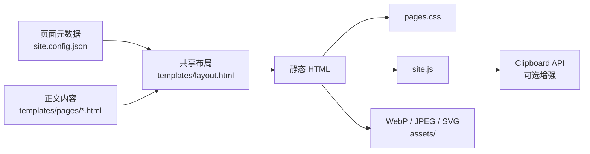

# 页面内容与媒体素材

## 目录
1. [简介](#简介)
2. [项目结构](#项目结构)
3. [核心组件](#核心组件)
4. [架构总览](#架构总览)
5. [详细组件分析](#详细组件分析)
6. [依赖关系分析](#依赖关系分析)
7. [性能与一致性考量](#性能与一致性考量)
8. [故障排查指南](#故障排查指南)
9. [结论](#结论)

## 简介
本页描述作品集站点面向访客呈现的页面内容、导航关系和媒体素材。页面模板只承载展示层文案与截图引用，真实的模型、Workflow、RPA 或数据分析后端不在本仓库中；`site.config.json` 负责页面元数据，`templates/layout.html` 负责共享外壳与分享标签。

- 页面由首页、案例目录、三张案例详情、经历、关于和联系共八类入口组成。
- 案例素材使用 WebP 截图，分享卡片使用固定的 JPEG 预览图。
- 联系方式、经历起始月份和页面描述从共享配置或布局占位符生成。

章节来源
- [README.md:3-13](file://README.md#L3-L13)
- [site.config.json:1-17](file://site.config.json#L1-L17)
- [templates/layout.html:1-27](file://templates/layout.html#L1-L27)

## 项目结构
页面正文集中在 `templates/pages/`，各文件按导航清单中的 HTML 文件名对应一个入口。布局和配置不复制到正文中，而是由构建器统一插入，因此内容修改应优先落在模板源文件。

```text
site.config.json
├── pages[]                  # 8 个页面的文件名、标签、标题和摘要
templates/
├── layout.html              # 导航、分享元数据、页脚和正文插槽
└── pages/
    ├── index.html           # 首页定位与入口卡片
    ├── portfolio.html       # 案例目录
    ├── case-content.html    # 内容自动化案例
    ├── case-visual.html     # 视觉生成案例
    ├── case-data.html       # 数据分析与自动化案例
    ├── resume.html          # 工作与教育经历
    ├── about.html           # 工作方式与求职方向
    └── contact.html         # 电话和邮箱入口
assets/
├── content-automation-workflow.webp
├── visual-generation-workflow.webp
├── product-image-data-grid.webp
├── social-preview.jpg
└── favicon.svg
```

首页的入口卡片分别指向案例、经历和关于页面，案例目录再指向三个具体案例。详情模板中的图片路径均相对页面使用，布局则统一加载 favicon、样式、脚本和联系动作。



图表来源
- [site.config.json:8-16](file://site.config.json#L8-L16)
- [templates/pages/index.html:62-83](file://templates/pages/index.html#L62-L83)
- [templates/pages/portfolio.html:10-41](file://templates/pages/portfolio.html#L10-L41)
- [templates/layout.html:23-27](file://templates/layout.html#L23-L27)

章节来源
- [site.config.json:8-16](file://site.config.json#L8-L16)
- [templates/pages/index.html:62-83](file://templates/pages/index.html#L62-L83)
- [templates/pages/portfolio.html:10-41](file://templates/pages/portfolio.html#L10-L41)
- [templates/layout.html:29-52](file://templates/layout.html#L29-L52)

## 核心组件
下表按访客浏览路径和内容类型梳理页面组件；案例详情与个人信息页共同复用同一布局，但各自保持独立正文。

| 组件 | 关键文件 | 一句话职责 |
| --- | --- | --- |
| 首页入口 | `templates/pages/index.html` | 说明 AI 产品经理定位，并把访客引向案例、经历和关于页。 |
| 案例目录 | `templates/pages/portfolio.html` | 提供内容自动化、视觉生成、数据分析三个案例入口。 |
| 案例详情 | `templates/pages/case-content.html`、`case-visual.html`、`case-data.html` | 分别展示问题、方案、Workflow、数据和截图证据。 |
| 个人信息页 | `templates/pages/resume.html`、`about.html` | 呈现工作教育时间线、工作方式和期望机会。 |
| 联系页与布局 | `templates/pages/contact.html`、`templates/layout.html` | 输出电话、邮箱、导航、SEO 分享标签和页脚联系链接。 |
| 媒体资源 | `assets/*.webp`、`assets/social-preview.jpg`、`assets/favicon.svg` | 支撑案例证据、分享预览和品牌图标。 |

页面标题、摘要和导航标签不是散落在正文里的重复数据，而是由配置清单集中声明；布局中的 `{{TITLE}}`、`{{DESCRIPTION}}`、`{{IMAGE}}` 等占位符负责承接这些值。

章节来源
- [site.config.json:8-16](file://site.config.json#L8-L16)
- [templates/pages/case-content.html:7-33](file://templates/pages/case-content.html#L7-L33)
- [templates/pages/case-visual.html:11-32](file://templates/pages/case-visual.html#L11-L32)
- [templates/pages/case-data.html:11-28](file://templates/pages/case-data.html#L11-L28)
- [templates/layout.html:7-27](file://templates/layout.html#L7-L27)

## 架构总览
访客先从布局生成的导航或首页入口进入页面，案例目录再把流量分配到三个详情模板。详情页中的图片是静态证据，联系页则输出可点击的电话和邮箱；`site.js` 只更新日期、任职时长和复制邮箱状态，不负责加载任何案例后端数据。



图表来源
- [templates/layout.html:23-52](file://templates/layout.html#L23-L52)
- [templates/pages/portfolio.html:10-41](file://templates/pages/portfolio.html#L10-L41)
- [templates/pages/case-content.html:16-18](file://templates/pages/case-content.html#L16-L18)
- [site.js:5-42](file://site.js#L5-L42)

章节来源
- [templates/layout.html:29-52](file://templates/layout.html#L29-L52)
- [templates/pages/portfolio.html:10-41](file://templates/pages/portfolio.html#L10-L41)
- [site.js:5-42](file://site.js#L5-L42)

## 详细组件分析
页面内容可按“入口定位、案例证据、个人资料、联系动作”四个主题理解。每个主题都在静态模板中完成，构建器只负责共享字段和外壳拼接。

### 首页与导航入口
首页 Hero 说明 AI 产品经理、电商业务和 Workflow 定位，并列出内容自动化、商品视觉生成、RPA 流程和数据分析四个实践方向。能力概览用四个指标条压缩展示经验重点，底部三张入口卡片将访客带到案例、经历和关于页面。

章节来源
- [templates/pages/index.html:1-36](file://templates/pages/index.html#L1-L36)
- [templates/pages/index.html:39-83](file://templates/pages/index.html#L39-L83)

### 案例目录与详情
案例目录把内容生产、视觉生成和数据分析与自动化作为三类产品案例，并在卡片中说明所用 Workflow、模型 API、Prompt、RPA 和 Excel Macro。内容自动化详情描述业务问题、方案和批量处理指标；视觉详情描述输入、约束与筛选；数据详情覆盖竞品色系、预测探索和固定操作自动化。

三个详情页各自引用一张截图：内容页使用 `assets/content-automation-workflow.webp`，视觉页使用 `assets/visual-generation-workflow.webp`，数据页使用 `assets/product-image-data-grid.webp`。图片都声明 `width`、`height`、`loading="lazy"`、`decoding="async"` 和中文 `alt`，让布局尺寸和无障碍文本在图片加载前已有依据。
下表记录模板中声明的图片尺寸；这些是页面保留的原始宽高，浏览器可再按 CSS 容器缩放显示。

| 文件路径 | 宽 × 高 | 页面 | 替代文本 |
| --- | --- | --- | --- |
| `assets/content-automation-workflow.webp` | 1534 × 355 | 内容自动化详情 | 电商标题与种草文案自动化 Workflow 截图 |
| `assets/visual-generation-workflow.webp` | 1160 × 788 | 商品视觉详情 | 商品视觉生成与图像模型 Workflow 截图 |
| `assets/product-image-data-grid.webp` | 1271 × 916 | 数据分析详情 | 商品图数据分析矩阵截图 |

章节来源
- [templates/pages/portfolio.html:10-41](file://templates/pages/portfolio.html#L10-L41)
- [templates/pages/case-content.html:7-33](file://templates/pages/case-content.html#L7-L33)
- [templates/pages/case-visual.html:11-32](file://templates/pages/case-visual.html#L11-L32)
- [templates/pages/case-data.html:11-28](file://templates/pages/case-data.html#L11-L28)
- [README.md:13-13](file://README.md#L13-L13)

### 经历、关于与联系
经历页提供 2025 年 7 月至今的电商运营时间线和 2021—2025 年教育经历，并把 AI 预测、视觉生产、Prompt、Workflow、RPA 等能力放到业绩和标签中。关于页将工作方式归纳为理解场景、低成本验证和沉淀复用流程；联系页把电话和 QQ 邮箱包装成 `tel:` 与 `mailto:` 链接。

工作起始月份同时出现在经历文案的 `data-experience-start` 和配置的 `workStart` 中，构建器和浏览器脚本据此生成任职时长。布局还提供带 `noscript` 退化路径的邮件链接，确保禁用 JavaScript 时仍可联系。

章节来源
- [templates/pages/resume.html:1-52](file://templates/pages/resume.html#L1-L52)
- [templates/pages/about.html:1-22](file://templates/pages/about.html#L1-L22)
- [templates/pages/contact.html:1-18](file://templates/pages/contact.html#L1-L18)
- [site.config.json:2-7](file://site.config.json#L2-L7)
- [templates/layout.html:37-43](file://templates/layout.html#L37-L43)

### 分享与品牌素材
布局为每页输出 `description`、Open Graph、Twitter 和 canonical 元数据；`IMAGE` 固定指向 `assets/social-preview.jpg`，所以不同页面共享同一张分享预览图。`assets/favicon.svg` 使用深色圆角方块和白色 W 的矢量路径，与页头品牌标记保持一致，不依赖本地字体。

README 说明三张案例截图保持原尺寸的无损 WebP，分享预览则采用 JPEG 以兼容分享客户端。素材本身只承担展示和分享职责，页面没有从远程 API 读取模型或 Workflow 结果。

章节来源
- [templates/layout.html:7-24](file://templates/layout.html#L7-L24)
- [README.md:11-13](file://README.md#L11-L13)
- [assets/favicon.svg:1-6](file://assets/favicon.svg#L1-L6)

## 依赖关系分析
页面渲染只依赖模板、配置、浏览器静态资源和少量原生脚本能力。案例内容与媒体文件通过相对路径连接，页面不声明外部运行时服务；联系动作由浏览器处理 `tel:`、`mailto:` 和 Clipboard API。



图表来源
- [site.config.json:8-16](file://site.config.json#L8-L16)
- [templates/layout.html:7-27](file://templates/layout.html#L7-L27)
- [templates/layout.html:37-51](file://templates/layout.html#L37-L51)
- [site.js:17-42](file://site.js#L17-L42)

章节来源
- [templates/layout.html:7-27](file://templates/layout.html#L7-L27)
- [templates/layout.html:37-51](file://templates/layout.html#L37-L51)
- [site.js:17-42](file://site.js#L17-L42)
- [README.md:11-13](file://README.md#L11-L13)

## 性能与一致性考量
页面将案例截图标记为异步解码、延迟加载并声明原始宽高，减少图片加载对布局稳定性的影响。布局和正文静态生成后可直接被抓取，分享元数据固定输出；脚本仅在浏览器加载后补充动态文本和复制邮箱状态。

- WebP 截图保留原尺寸与逐像素一致性，适合作为案例证据。
- `loading="lazy"` 让首屏外的案例图片按需加载，`width` 和 `height` 为布局预留空间。
- `social-preview.jpg` 作为固定预览图，尺寸在布局中声明为 1534 × 355。
- 联系功能有静态 `mailto:` 退化路径；Clipboard API 不可用时显示可手动选择的邮箱。

章节来源
- [README.md:11-13](file://README.md#L11-L13)
- [templates/layout.html:14-22](file://templates/layout.html#L14-L22)
- [templates/pages/case-content.html:16-18](file://templates/pages/case-content.html#L16-L18)
- [templates/pages/case-visual.html:29-32](file://templates/pages/case-visual.html#L29-L32)
- [templates/pages/case-data.html:25-28](file://templates/pages/case-data.html#L25-L28)
- [site.js:17-39](file://site.js#L17-L39)

## 故障排查指南
排查页面内容时先看对应正文模板和配置中的页面条目，再确认布局是否仍插入资源路径、元数据和联系动作；图片问题则核对文件名、尺寸属性和部署目录是否包含资源。

- **导航标签、标题或摘要不一致** → 原因是 `site.config.json` 页面条目与模板文件名不匹配或字段未更新 → 同时检查 `pages[]` 的 `file`、`label`、`title`、`description` 与对应 `templates/pages/<file>` → 相关位置为配置清单和布局元数据占位符。
- **案例截图不显示** → 原因是相对路径、资源文件名或部署复制缺失 → 对照详情页 `src`、`width`、`height` 与 `assets/` 实际文件，并确认部署目录包含 `assets/` → 相关位置为三份案例模板和 README 素材约定。
- **分享卡片错误** → 原因是布局中的固定 `IMAGE` 或 Open Graph/Twitter 字段被改动 → 检查 `og:image`、`twitter:image`、canonical 和站点 URL 是否仍由生成器填入 → 相关位置为 `templates/layout.html` 与 `site.config.json`。
- **任职时长或复制邮箱没有更新** → 原因是 `data-experience-start`、配置起始月份或浏览器 Clipboard API 状态不一致 → 检查经历页标记、`site.config.json` 的 `workStart` 及 `site.js` 的错误退化文案 → 相关位置为经历模板和脚本。

章节来源
- [site.config.json:4-16](file://site.config.json#L4-L16)
- [templates/layout.html:7-27](file://templates/layout.html#L7-L27)
- [templates/pages/case-content.html:16-18](file://templates/pages/case-content.html#L16-L18)
- [templates/pages/case-visual.html:29-32](file://templates/pages/case-visual.html#L29-L32)
- [templates/pages/case-data.html:25-28](file://templates/pages/case-data.html#L25-L28)
- [site.js:5-42](file://site.js#L5-L42)

## 结论
页面层是一个以静态模板为核心的作品集展示系统：首页负责定位和分流，案例页负责叙述问题与证据，经历/关于页负责补充背景，联系页负责转化动作。维护时应同步更新配置清单、对应正文模板和 `assets/` 文件，并保留截图尺寸、替代文本、分享字段和 JavaScript 退化路径。

章节来源
- [README.md:3-13](file://README.md#L3-L13)
- [site.config.json:8-16](file://site.config.json#L8-L16)
- [templates/layout.html:7-52](file://templates/layout.html#L7-L52)

<cite>
**本文引用的文件**
- [templates/pages/index.html](file://templates/pages/index.html)
- [templates/pages/portfolio.html](file://templates/pages/portfolio.html)
- [templates/pages/case-content.html](file://templates/pages/case-content.html)
- [templates/pages/case-visual.html](file://templates/pages/case-visual.html)
- [templates/pages/case-data.html](file://templates/pages/case-data.html)
- [templates/pages/resume.html](file://templates/pages/resume.html)
- [templates/pages/about.html](file://templates/pages/about.html)
- [templates/pages/contact.html](file://templates/pages/contact.html)
- [templates/layout.html](file://templates/layout.html)
- [site.config.json](file://site.config.json)
- [README.md](file://README.md)
- [assets/favicon.svg](file://assets/favicon.svg)
- [site.js](file://site.js)
</cite>

